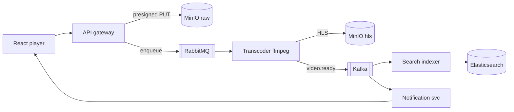
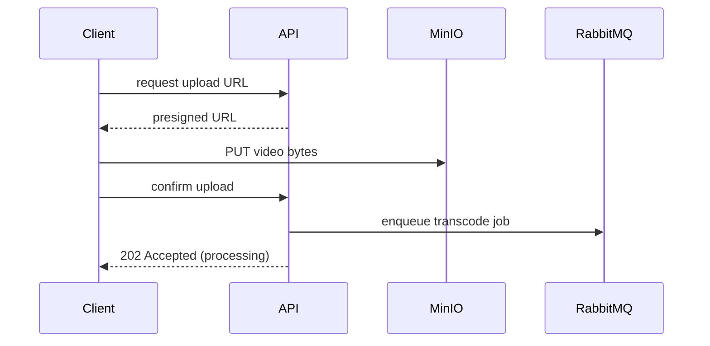
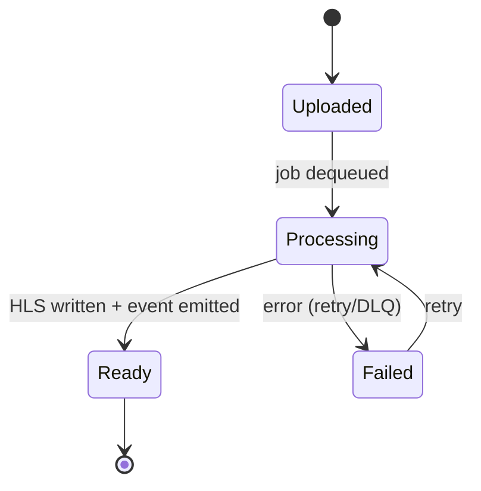
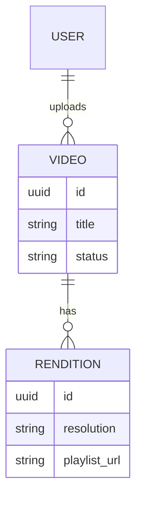

# Documentation with Mermaid

## Rule

All documentation is **Markdown**. For **architecture and design** visuals, use **Mermaid**
diagrams embedded in the Markdown (not ASCII art, not external image files).

**Always follow the `markdown-lint` skill** when writing or editing any Markdown — every
`.md` file must pass markdownlint rules (notably MD040: every code fence declares a
language; use `mermaid` for diagrams).

## When to use which diagram

| Need | Mermaid diagram |
|------|-----------------|
| Service / component architecture | `flowchart` or `graph` |
| Request / message flow over time | `sequenceDiagram` |
| Data model / entities | `erDiagram` |
| State of a resource (e.g. video lifecycle) | `stateDiagram-v2` |
| Deployment topology (k8s, envs) | `flowchart` with subgraphs |
| Phases / milestones | `gantt` or `timeline` |

## Conventions

- One diagram per concept; keep it readable over exhaustive.
- Use `subgraph` to group by service, bucket, or environment.
- Label edges with the action/event (`presigned PUT`, `video.ready`).
- Keep node names short; explain detail in prose below the diagram.
- Always pair a diagram with a sentence or two of prose context.

## Examples

### Architecture (flowchart)

### Flow (sequenceDiagram)

### Video lifecycle (stateDiagram)

### Data model (erDiagram)

