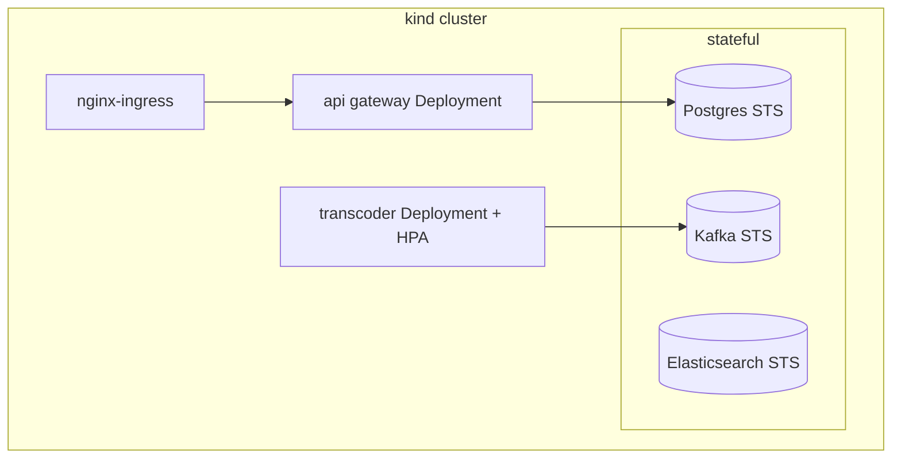

# Kubernetes — kind + Helm + HPA

Local Kubernetes for the scaling and resilience lessons.

## Topology

- **kind** cluster (1 control-plane + 1 worker) via `infra/k8s/kind-config.yaml`.
- **Helm** umbrella chart with a subchart per service.
- **Metrics Server** for HPA.
- Stateless services as **Deployments**; Kafka/Postgres/Elasticsearch as **StatefulSets** + PVCs.



## HPA — the payoff lesson

Autoscale the transcoder by load. Start with CPU/memory targets (e.g. CPU 50%, mem 70%,
2→6 replicas). The advanced version: scale by **queue depth** (RabbitMQ) using a custom
metric so workers scale to drain back-pressure. Drive it with k6 (see `testing-strategy`).

## Windows / Docker Desktop image-loading trick

Docker Desktop uses a containerd image store; `kind load docker-image` can misbehave.
Load images into kind reliably by exporting and importing with `ctr`:

```bash
# export built image to a tarball, then inside the kind node:
ctr --namespace k8s.io images import --no-unpack <image>.tar
```

A `load-images.ps1` script automates: retag → export → `ctr import --no-unpack` into the
kind node. Use `imagePullPolicy: IfNotPresent` with simple local tags.

## Conventions

- Config via **ConfigMaps**; secrets via **Secrets**. The local↔cloud endpoint swap is a
  ConfigMap change (ties to ports/adapters).
- Resource `requests`/`limits` on ffmpeg workers — they are CPU-hungry; scheduling and HPA
  depend on correct requests.
- Model a transcode as either a long-running Deployment consumer **or** a K8s `Job`;
  comparing the two is itself a lesson.

## Script pattern (package.json)

Mirror the `start|stop:env:service` convention:

```bash
start:k          # create cluster + build + load images + helm install
start:k:up       # recreate cluster, images already built
stop:k           # delete cluster
status:k:hpa     # watch autoscaling
logs:k:app       # tail service logs
```
