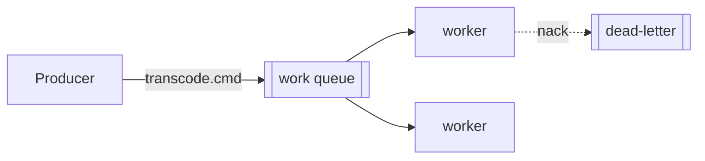
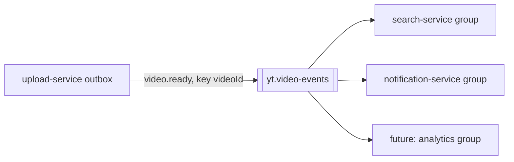

# Messaging Patterns — RabbitMQ (commands) + Kafka (events)

Use the right tool for the right job. The two are **not** interchangeable.

## Decision rule

| Job                                                      | Semantics                                       | Tool             |
| -------------------------------------------------------- | ----------------------------------------------- | ---------------- |
| "Do this work" (one job → one worker)                    | work queue: ack, retry, DLQ, prefetch           | **RabbitMQ**     |
| "This happened" (one event → many consumers, replayable) | event log: partitions, offsets, consumer groups | **Apache Kafka** |

In this project: RabbitMQ carries the **transcode command**; Kafka carries the
**`video.ready` event** fanned out to search + notifications.

## RabbitMQ (command queue)

- **Ack after success**; reject → retry or route to **DLQ**. In Spring, `AcknowledgeMode.AUTO` acks when the
  listener returns and rejects when it throws; set `default-requeue-rejected: false` so a poison message is
  dead-lettered instead of redelivered forever.
- **Prefetch** limits in-flight messages per consumer = back-pressure (1 for heavy jobs like transcoding).
- One queue, **competing consumers** = horizontal scale.
- Scale worker count (or k8s replicas via HPA) by queue depth.
- Prefer **quorum queues** (replicated, durable, support delivery limits) over classic queues.
- **Publisher confirms**: a publish is done only after the broker confirms it (`createConfirmChannel` in
  amqplib). Without confirms a "successful" publish can still be lost.
- **Topology on both sides**: producer and consumer declare the same exchange, queue and bindings with
  identical arguments, so either can start first. Different arguments → `PRECONDITION_FAILED`; pin them with a
  test on each side.

### Commands go through the outbox

`POST /uploads/:id/complete` updates the video and inserts an `outbox` row in **one transaction**, so either
both happen or neither does. `OutboxRelay` claims due rows with
`UPDATE outbox SET locked_until = now + 30 s WHERE id IN (SELECT ... FOR UPDATE SKIP LOCKED) RETURNING ...`:
several replicas get disjoint batches, no transaction stays open while publishing, and a crashed relay's
rows become due again when the lease expires. It publishes with confirms, then marks the row sent; a
failure schedules a retry with backoff. A crash between publish and mark-sent re-sends, so delivery is
at least once and the row id doubles as the `messageId` consumers dedupe on.

Before the outbox existed the rule was: publish first, then update the row (the reverse silently loses
jobs). The outbox removes the choice and the 503.

In this project: exchange `yt.transcode` (direct), routing key `transcode.cmd`, queue
`transcoder.transcode-video`, DLX `yt.transcode.dlx`, DLQ `transcoder.transcode-video.dlq`. Names live in
`apps/upload-service/src/messaging/transcode-topology.ts` and `adapter/in/messaging/TranscodeTopology.java`.



## Kafka (event log)

- **Partitions** give ordering per key (e.g. per videoId) and parallelism.
- **Consumer groups** read independently; add a new group later to **replay history**
  (backfill a brand-new service without touching producers).
- Commit offsets after processing.
- Local setup: topic `yt.video-events` (3 partitions, key = videoId, compacted) and `yt.video-events.dlt`,
  created by the one-shot `kafka-setup` container with auto-create off. Host clients bootstrap from
  `localhost:9094` (`EXTERNAL` listener); containers use `kafka:9092`. Kafka 3.5 = Confluent Platform 7.5,
  which is the oldest version `@platformatic/kafka` is tested against.



- **A hung broker does not fail, it waits.** Bound every publish with a timeout shorter than the outbox
  lease (10 s vs 30 s here). A timed-out send can still be delivered later, so expect duplicates with the
  same `eventId`; the idempotent producer only removes duplicates within its own retries.
- Event schemas live in `libs/ts/contracts` (`@yt/contracts`): Zod schema, topic and header names, shared by
  producer and consumers. Not strict (tolerant reader), so adding a field breaks nobody.
- **Work-sharing vs fan-out groups.** Same group id on every instance = the partitions are split, each event
  handled once (search indexer). Unique group id per instance, `latest`, no commits = every instance sees
  every event (notification-service, whose sockets live on one instance each).

## Transactional outbox (the dual-write problem)

Never write to the DB **and** publish an event as two independent steps — one can fail.
Instead: within the same DB transaction, write the domain row **and** an `outbox` row. A
relay (poller or CDC) publishes outbox rows to Kafka, then marks them sent.

```mermaid
sequenceDiagram
  participant S as Service
  participant DB as Postgres
  participant R as Outbox relay
  participant K as Kafka
  S->>DB: TX { update video; insert outbox(video.ready) }
  R->>DB: poll unsent outbox
  R->>K: publish video.ready
  R->>DB: mark outbox sent
```

## Idempotency (mandatory)

Both RabbitMQ and Kafka are **at-least-once** — the same message can arrive twice.
Every consumer must be idempotent:

- Dedupe by a stable key (messageId / eventId) stored in a processed-ids table, or
- Make the operation naturally idempotent (upsert by videoId, not insert).
- For status events: allow only forward transitions with a conditional update
  (`UPDATE ... WHERE status IN (allowed previous states)`); duplicates and late events then change nothing.

## Retries & DLQ

- Retry with backoff a bounded number of times.
- After max retries, route to a DLQ for inspection — never silently drop.
- Alert/observe DLQ depth.
- Classify failures: permanent (bad input) → DLQ at once; transient (dependency down) → retry.
- Delayed retry without plugins: a consumer-less **retry queue** with a TTL that dead-letters back to the
  work exchange; carry the attempt number in a header (`x-yt-attempt`). The consumer never sleeps.
- Test messaging end to end in a throwaway **vhost** (`PUT /api/vhosts/<name>` on the management API), so
  a developer's running consumers cannot take the test messages.

## Contracts

- Generate the message JSON Schema from the producer's Zod schema into `contracts/<message>.schema.json`
  (same `pnpm api:generate` as OpenAPI). The Java side tests its record against that file, so drift on either
  side fails a build. Example: `contracts/transcode-command.schema.json`.
- Give every message a `messageId` and an ISO timestamp; set them as AMQP properties too.
- AsyncAPI (`@asyncapi/cli`) is the next step once there are several channels.
