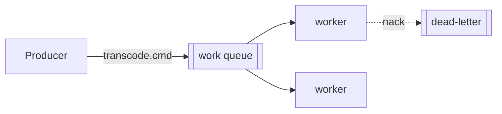
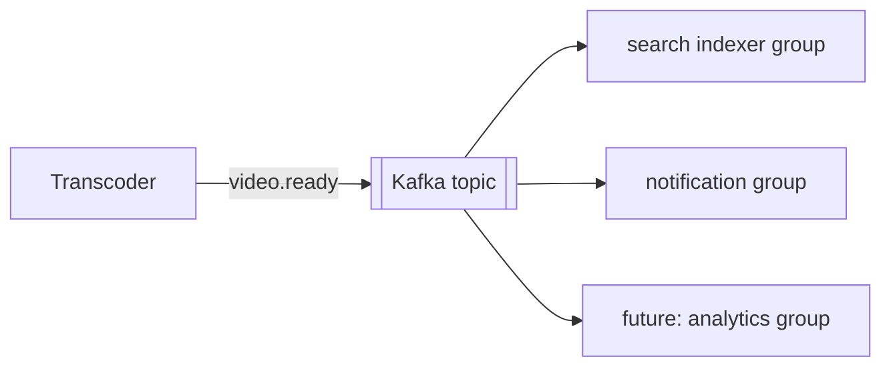

# Messaging Patterns — RabbitMQ (commands) + Kafka (events)

Use the right tool for the right job. The two are **not** interchangeable.

## Decision rule

| Job | Semantics | Tool |
|-----|-----------|------|
| "Do this work" (one job → one worker) | work queue: ack, retry, DLQ, prefetch | **RabbitMQ** |
| "This happened" (one event → many consumers, replayable) | event log: partitions, offsets, consumer groups | **Apache Kafka** |

In this project: RabbitMQ carries the **transcode command**; Kafka carries the
**`video.ready` event** fanned out to search + notifications.

## RabbitMQ (command queue)

- **Manual ack** after success; `nack`/reject → retry or route to **DLQ**.
- **Prefetch** limits in-flight messages per consumer = back-pressure.
- One queue, **competing consumers** = horizontal scale.
- Scale worker count (or k8s replicas via HPA) by queue depth.



## Kafka (event log)

- **Partitions** give ordering per key (e.g. per videoId) and parallelism.
- **Consumer groups** read independently; add a new group later to **replay history**
  (backfill a brand-new service without touching producers).
- Commit offsets after processing.



## Transactional outbox (the dual-write problem)

Never write to the DB **and** publish an event as two independent steps — one can fail.
Instead: within the same DB transaction, write the domain row **and** an `outbox` row. A
relay (poller or CDC) publishes outbox rows to Kafka, then marks them sent.

```mermaid
sequenceDiagram
  participant S as Service
  participant DB as Postgres
  participant R as Outbox relay
  participant K as Kafka
  S->>DB: TX { update video; insert outbox(video.ready) }
  R->>DB: poll unsent outbox
  R->>K: publish video.ready
  R->>DB: mark outbox sent
```

## Idempotency (mandatory)

Both RabbitMQ and Kafka are **at-least-once** — the same message can arrive twice.
Every consumer must be idempotent:

- Dedupe by a stable key (messageId / eventId) stored in a processed-ids table, or
- Make the operation naturally idempotent (upsert by videoId, not insert).

## Retries & DLQ

- Retry with backoff a bounded number of times.
- After max retries, route to a DLQ for inspection — never silently drop.
- Alert/observe DLQ depth.

## Contracts

- Document events with **AsyncAPI** (`@asyncapi/cli`) — "OpenAPI for queues".
- Keep event schemas in the shared `libs/ts/contracts` (and a Java mirror) so Node and Java
  services agree on the wire format.
