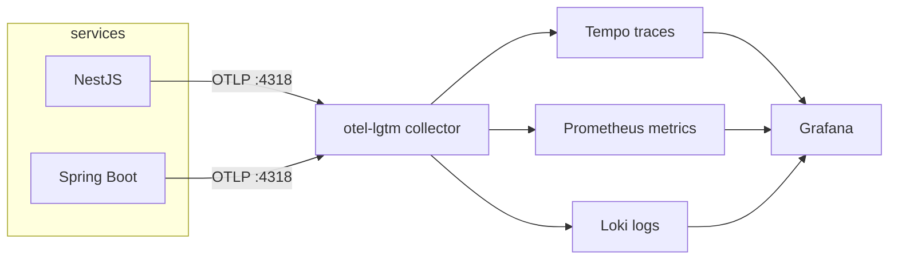

# Observability — OpenTelemetry + grafana/otel-lgtm

One all-in-one observability container, OTLP everywhere, traces correlated across services.

## The stack

Use the single **`grafana/otel-lgtm`** image (Loki + Grafana + Tempo + Prometheus + OTLP
collector). Only runs in the `local-observability` and `aws` environments.

- OTLP gRPC: `:4317`
- OTLP HTTP: `:4318`
- Grafana UI: `:3000`

All services export to the collector's OTLP endpoint. No per-service exporters to wire up.

## Node (NestJS)

- Use the `@opentelemetry/sdk-node` + auto-instrumentations.
- Set `OTEL_EXPORTER_OTLP_ENDPOINT=http://otel-lgtm:4318`,
  `OTEL_SERVICE_NAME=<service>`.
- Propagate trace context across HTTP and across RabbitMQ/Kafka messages (inject/extract
  headers) so a trace spans the whole pipeline.

## Java (Spring Boot)

- Micrometer Tracing + OTLP exporter (`management.otlp.tracing.endpoint`).
- Expose Prometheus via Actuator if scraping; otherwise push via OTLP.
- Same `OTEL_SERVICE_NAME` convention.

## Rules

- **One trace, end to end.** The payoff: a single upload trace crossing
  React → NestJS → RabbitMQ → Spring transcoder → Kafka → indexer. This requires context
  propagation through the message brokers, not just HTTP.
- Profile-gate observability: off in `local`, on in `local-observability` / `aws`,
  sampling 1.0 locally for full visibility.
- Include `traceId` in structured logs so logs ↔ traces correlate in Grafana.
- **Dropped:** Pyroscope (Linux-only, flaky on Windows) — not part of this stack.

## Three pillars

| Pillar | Signal | Where |
|--------|--------|-------|
| Metrics | request rate, queue depth, worker count | Prometheus → Grafana |
| Traces | end-to-end request/pipeline spans | Tempo → Grafana |
| Logs | structured, trace-correlated | Loki → Grafana |
