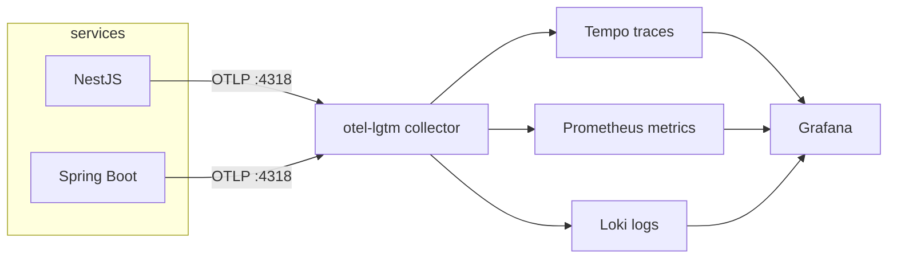

# Observability — OpenTelemetry + grafana/otel-lgtm

One all-in-one observability container, OTLP everywhere, traces correlated across services.

## The stack

Use the single **`grafana/otel-lgtm`** image (Loki + Grafana + Tempo + Prometheus + OTLP
collector). Only runs in the `local-observability` and `aws` environments.

- OTLP gRPC: `:4317`
- OTLP HTTP: `:4318`
- Grafana UI: `:3000`

All services export to the collector's OTLP endpoint. No per-service exporters to wire up.

## Node (NestJS)

- Shared preload `@yt/telemetry/register` passed with `--import` in every script; it starts `NodeSDK`
  (0.300) only when `telemetryEnabled()` (`APP_ENV=local-observability` or `OTEL_ENABLED=true`). ESM needs
  `import-in-the-middle/register-hooks.mjs` (sync `module.registerHooks`; fall back to `module.register`).
- `OTEL_EXPORTER_OTLP_ENDPOINT=http://localhost:4318`, `OTEL_SERVICE_NAME=<service>` in `.env.sample`.
- Logs API lives in `@opentelemetry/api` now (`logs`, `SeverityNumber`); `@opentelemetry/api-logs`
  silently yields a no-op logger. `OtelConsoleLogger` mirrors Nest logs to OTel with the active context.
- sdk-* 3.0 processors take options objects: `new BatchLogRecordProcessor({ exporter })`,
  `new SimpleSpanProcessor({ exporter })`; the provider class is `TracerProvider`.
- Brokers: amqplib is auto-instrumented; `@platformatic/kafka` is not, so use `withProducerSpan` /
  `withConsumerSpan` (W3C `traceparent` in record headers). Through an outbox, store `injectContext()` on
  the row and publish inside `withStoredContext(row.traceContext, ...)`.
- Wrap pollers and metric-gauge callbacks that hit the DB in `untraced(...)`, or every tick is a root trace.

## Java (Spring Boot)

- `spring-boot-starter-opentelemetry` (Boot 4.1): `management.tracing.export.enabled`,
  `management.opentelemetry.tracing.export.otlp.endpoint`, `management.otlp.metrics.export.*`,
  `management.logging.export.otlp.enabled` — off in `application.yaml`, on in the `local-observability`
  profile. RabbitMQ propagation: `spring.rabbitmq.{listener.simple,template}.observation-enabled: true`.
- Logs: `opentelemetry-logback-appender-1.0` installed on Boot's `OpenTelemetry` bean. Pin its version to the
  release built on Boot's managed SDK (check the instrumentation BOM), not the newest — a mismatch fails at
  runtime with `NoClassDefFoundError` from `api-incubator`.
- Service name = `spring.application.name`.

## Rules

- **One trace, end to end.** The payoff: a single upload trace crossing
  React → NestJS → RabbitMQ → Spring transcoder → Kafka → indexer. This requires context
  propagation through the message brokers, not just HTTP.
- Profile-gate observability: off in `local`, on in `local-observability` / `aws`,
  sampling 1.0 locally for full visibility.
- Include `traceId` in structured logs so logs ↔ traces correlate in Grafana.
- **Dropped:** Pyroscope (Linux-only, flaky on Windows) — not part of this stack.

## Three pillars

| Pillar  | Signal                                  | Where                |
| ------- | --------------------------------------- | -------------------- |
| Metrics | request rate, queue depth, worker count | Prometheus → Grafana |
| Traces  | end-to-end request/pipeline spans       | Tempo → Grafana      |
| Logs    | structured, trace-correlated            | Loki → Grafana       |
