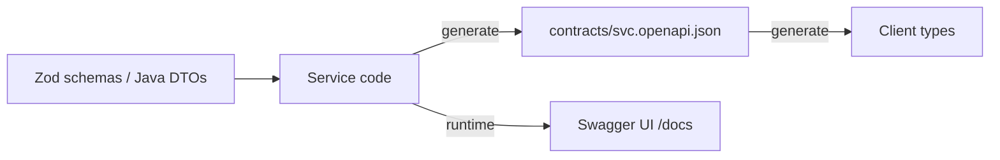

# OpenAPI Contracts

The spec is generated from the service code, committed, and consumed by clients. Nobody edits
the spec or the generated types by hand.

## Flow



## Rules

- **Code-first, one source of truth.** In NestJS the Zod schema validates requests _and_ feeds
  the spec; TypeScript types come from `z.infer`. Never keep a second hand-written type.
- **Name every shared schema** with `.meta({ id: "VideoPage" })`. Named schemas become
  `components.schemas` entries and `$ref`s, so clients get readable type names.
- **Document each endpoint:** `@ApiTags`, `@ApiOperation({ operationId, summary })` (camelCase
  verb-noun id such as `confirmUpload`), `@ApiBody`/`@ApiQuery`/`@ApiParam`, one response
  decorator per status including errors, and `@ApiBearerAuth()` on protected controllers.
- **Commit the output.** `contracts/<service>.openapi.json` and the generated client types are
  in git, so a contract change shows up in the diff and in review.
- **Keep it current automatically.** The service rewrites the spec when it starts in a non-deployed
  env (only if the content changed). The web `dev` script regenerates types from the spec first.
  A pre-commit hook runs `pnpm api:generate` and stages `contracts/` and the generated types
  whenever service source is staged.
- **Regenerate by hand** with `pnpm api:generate`. `pnpm api:check` regenerates and fails on a
  diff; run it in CI.
- **Swagger UI** is served by the service at `/docs` (raw spec at `/docs-json`) in local envs.

## NestJS + Zod 4 recipe

`nestjs-zod` does not support Nest 12 yet, so use Zod's own `z.toJSONSchema`:

- `src/openapi/openapi.ts` builds the document with `@nestjs/swagger` (`setOpenAPIVersion("3.1.0")`)
  and fills `components.schemas` from the Zod registry, deleting `$schema` and `$id` from each entry:

```ts
z.toJSONSchema(z.globalRegistry, {
  target: "draft-2020-12",
  uri: (id) => `#/components/schemas/${id}`,
});
```

- `src/openapi/decorators.ts` holds `schemaRef(name)`, `ApiJsonResponse` and `ApiErrorResponse`.
- `src/openapi/openapi-file.ts` writes the spec (only when it changed); `src/openapi/generate.ts`
  calls it using `NestFactory.create(AppModule, { preview: true })`, which needs no database,
  storage or identity provider. `main.ts` calls it too, for every env except `aws`.
- tsx emits no decorator metadata, so DTO classes and `@nestjs/swagger`'s CLI plugin are not
  used; always pass explicit schemas to the decorators.
- Use `z.enum(PrismaEnum)` so database enums appear as real enums in the contract.

## Client types (TypeScript)

- Generator: `openapi-typescript` (types only, no Java, no runtime code). Not
  `@openapitools/openapi-generator-cli`: it needs a JDK and emits heavy boilerplate.
- It needs the TypeScript 5 compiler API, which TypeScript 7 lacks, so the web script runs it with
  `pnpm dlx openapi-typescript@<pinned>` (it gets its own TS 5). Keep the version pinned.
- Command: `openapi-typescript ../../contracts/<svc>.openapi.json --immutable -o src/api/schema.d.ts`.
- App code imports named types from a thin `src/types.ts`
  (`components["schemas"]["VideoPage"]`); never import from the generated file everywhere.
- Add `contracts/` and the generated file to `.prettierignore` so formatters do not cause drift.

## Java services

Use springdoc-openapi to expose `/v3/api-docs`, export it to `contracts/<service>.openapi.json`
with the same commit-and-check rule, and generate TypeScript clients with the same tool.

## Verify

1. `pnpm api:generate`, then `git diff contracts apps/web/src/api` shows only intended changes.
2. Typecheck the service and the web app.
3. Start the service; `/docs` returns 200 and `/docs-json` equals the committed file.
4. Run the `http/` requests (see `api-http-requests`).
