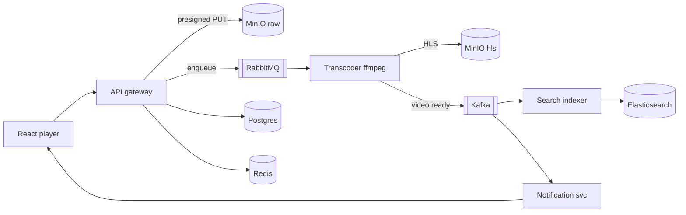

# Mini YouTube Clone

A learning-oriented, production-shaped mini video platform — upload, transcode, stream,
search, and notify — built to understand **system design** by implementing each layer end
to end with widely-used open-source tools.

This is not a toy happy-path tutorial. It is built in reviewable stages where each stage
forces one hard concept (async processing, adaptive streaming, event-driven search,
back-pressure, autoscaling) to be built, observed, broken, and fixed.

## Why this project

Learning distributed-systems concepts from articles rarely sticks. Here each concept shows
up as a concrete, running part of the product. See [`docs/LEARNING-GOALS.md`](docs/LEARNING-GOALS.md)
for the full concept map (CAP, outbox, messaging queues, eventual consistency, ABR, HPA, …).

## Tech stack

| Area                         | Choice                                                                    |
| ---------------------------- | ------------------------------------------------------------------------- |
| Backend API & light services | NestJS + TypeScript                                                       |
| Heavy / transcoding service  | Spring Boot 4.1 + Java 21                                                 |
| Frontend                     | React 19 + TypeScript + Vite + Tailwind v4 (no shadcn; shadcn-like theme) |
| Database                     | PostgreSQL (via Prisma)                                                   |
| Object storage               | MinIO (S3-compatible)                                                     |
| Command queue                | RabbitMQ                                                                  |
| Event log                    | Apache Kafka                                                              |
| Search                       | Elasticsearch                                                             |
| Cache                        | Redis                                                                     |
| Edge / CDN                   | nginx                                                                     |
| Transcoding                  | ffmpeg                                                                    |
| Identity                     | Keycloak (OIDC)                                                           |
| Observability                | grafana/otel-lgtm (OTLP)                                                  |
| Orchestration                | Docker Compose, kind + Helm (local k8s)                                   |
| Monorepo                     | pnpm workspaces (no Nx)                                                   |

Principle: **open-source-first.** Cloud (AWS/EKS, optional S3) appears only as a deploy
target. See [`docs/DECISIONS.md`](docs/DECISIONS.md).

## High-level architecture



Full detail in [`docs/architecture.md`](docs/architecture.md).

## Repository layout

```text
project-youtube-clone/
├── apps/        # web (React) + NestJS services + Spring Boot transcoder
├── libs/        # shared TS contracts/config/ports/ui + shared Java
├── infra/       # docker-compose + k8s (kind + helm)
├── load-testing/# k6 scripts
├── docs/        # PRD, LEARNING-GOALS, architecture, DECISIONS, SKILLS, TASKS
└── .kiro/       # specs, steering, skills (spec-driven workflow)
```

## Environments

| Env                   | Infra                                                            | Observability |
| --------------------- | ---------------------------------------------------------------- | ------------- |
| `local`               | Postgres, Redis, MinIO, RabbitMQ, Kafka, Elasticsearch, Keycloak | off           |
| `local-observability` | all of the above + grafana/otel-lgtm                             | on            |
| `aws`                 | EKS (optionally S3)                                              | on            |

## Documentation

- [`docs/PRD.md`](docs/PRD.md) — product requirements (learning-framed, tech-free)
- [`docs/HOW-TO-RUN.md`](docs/HOW-TO-RUN.md) — how to start, stop, and work with the project
- [`docs/IMAGES.md`](docs/IMAGES.md) — container images and versions used
- [`docs/LEARNING-GOALS.md`](docs/LEARNING-GOALS.md) — concepts, theory, and the OSS tool for each
- [`docs/architecture.md`](docs/architecture.md) — system architecture and flows
- [`docs/DECISIONS.md`](docs/DECISIONS.md) — architecture decision log (ADRs)
- [`docs/TASKS.md`](docs/TASKS.md) — stage-by-stage task tracker
- [`docs/SKILLS.md`](docs/SKILLS.md) — reusable skills index
- [`docs/prd-generation-prompt.md`](docs/prd-generation-prompt.md) — reusable PRD prompt

## Status

Early groundwork. See [`docs/TASKS.md`](docs/TASKS.md) for what is done and what is next.
Development proceeds **one task at a time**, reviewed before moving on.
