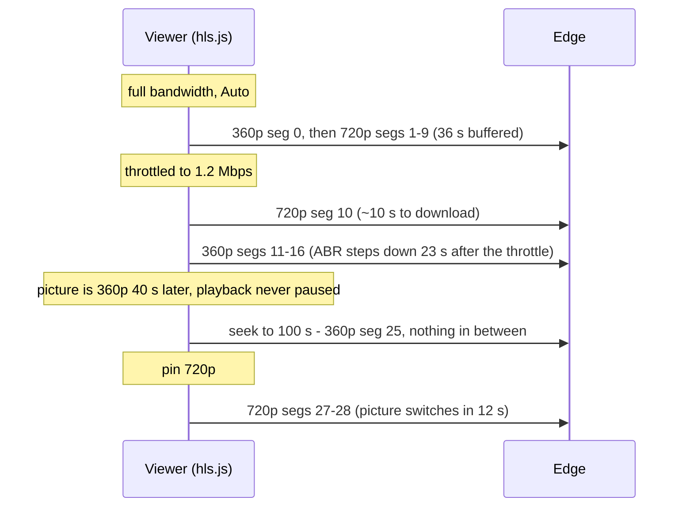
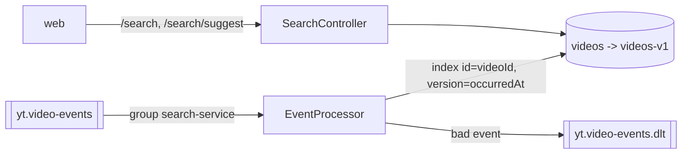
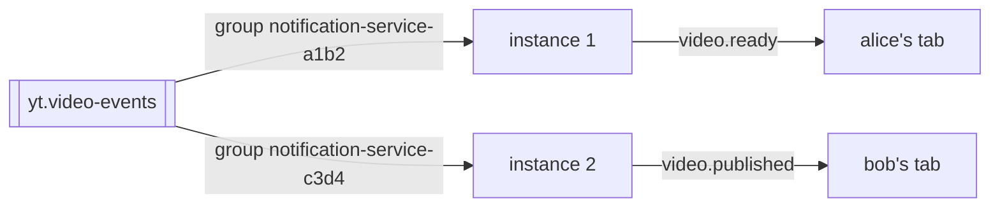

# Architecture Decision Log

A running log of meaningful decisions and reviews. Newest entries at the bottom.
Each entry: what we decided, why, and any trade-off or alternative considered.

Format: `## ADR-NNN — <title>` · Date · Status (Accepted / Superseded / Proposed)

---

## ADR-001 — Open-source-first; cloud only where it is the standard

Date: 2026-11-06 · Status: Accepted

Use the widely-adopted open-source container for each capability (MinIO, RabbitMQ, Kafka,
Elasticsearch, Redis, Postgres, nginx, ffmpeg, Keycloak, otel-lgtm). Reach for a cloud
service only when it is itself the industry standard with no OSS substitute worth learning.

AWS appears only as a deploy target: **EKS**, and optionally real **S3** (zero-code adapter
swap from MinIO). Nothing else.

Why: the goal is learning the real mechanics, not managed magic. OSS tools expose acks,
offsets, cache headers, and segmenting that managed services hide.

## ADR-002 — Messaging: RabbitMQ (commands) + Kafka (events), phased

Date: 2026-11-06 · Status: Accepted

Use both, deliberately: RabbitMQ for the "transcode this video" command (work-queue:
ack/DLQ/prefetch/back-pressure), Kafka for the "video.ready" event (log: partitions,
consumer groups, replay). Introduce RabbitMQ first (Phase 1), Kafka later (Phase 3) when a
second consumer makes the need concrete.

Alternative considered: Kafka-only (fewer moving parts) — rejected because experiencing
command-queue vs event-log side by side is a core learning objective.

## ADR-003 — Backend: NestJS for API/light services, Spring Boot for heavy

Date: 2026-11-06 · Status: Accepted

NestJS + TypeScript for the API/BFF and light services (DI container cleanly supports
ports/adapters). Spring Boot 4.1 + Java 21 for the transcoding worker (long-running JVM
workload, strong ffmpeg/queue ecosystem). Polyglot on purpose: forces language-agnostic
contracts (events, REST).

Not Next.js for the API: Next.js is a frontend framework; its API routes are ill-suited to
WebSockets, queue consumers, and hexagonal DI.

## ADR-004 — Frontend: React 19 + Vite + Tailwind v4, no shadcn

Date: 2026-11-06 · Status: Accepted

React 19 + TypeScript + Vite + Tailwind v4. No shadcn, but a shadcn-like theme (CSS
variable design tokens). Reusable components via tailwind-variants (amended by ADR-014).

## ADR-005 — Monorepo: pnpm workspaces, no Nx

Date: 2026-11-06 · Status: Accepted

pnpm workspaces for the JS side; Gradle multi-project for Java. No Nx — the goal is system
design, not build tooling. Revisit only if task-graph/caching pain becomes real.

## ADR-006 — Identity: Keycloak

Date: 2026-11-06 · Status: Accepted

Keycloak as the OIDC identity service (matches the reference starter, industry-standard,
and the container is available). Rust alternatives (Rauthy, Kanidm) and ZITADEL (Go) were
discussed; not adopted — auth should be a boring, solved dependency behind an OIDC adapter.

## ADR-007 — Observability: single grafana/otel-lgtm container

Date: 2026-11-06 · Status: Accepted

Use the all-in-one `grafana/otel-lgtm` image (Loki + Grafana + Tempo + Prometheus + OTLP
collector) instead of the reference starter's 5-container stack. All services export OTLP to
`:4318`. Pyroscope dropped (Linux-only, flaky on Windows; not needed).

## ADR-008 — Environments: local, local-observability, aws

Date: 2026-11-06 · Status: Accepted

Three environments. `local` (minimal infra, observability off), `local-observability` (adds
otel-lgtm, sampling 1.0), `aws` (EKS deploy target).

Dropped: `localstack` (redundant once we use real OSS tools instead of AWS services) and the
fully-containerized `docker` env (kind covers it).

## ADR-009 — Spec-driven workflow: Kiro Specs + this decision log

Date: 2026-11-06 · Status: Accepted

Use Kiro's native Spec workflow per feature (`requirements.md` / `design.md` / `tasks.md`)
instead of hand-rolled spec.md/plan.md. Use this `DECISIONS.md` as the review/decision log
instead of a review.md. Development proceeds step by step, one task at a time, reviewed
before moving on.

## ADR-010 — Skills: project-level now, promote to global later

Date: 2026-11-06 · Status: Accepted

Keep all skills in `.kiro/skills/` (workspace) for now. `docs/SKILLS.md` records which are
good candidates to promote to `~/.kiro/skills/` (user-level, available in every project).

## ADR-011 — Pattern per service: layered MVC for CRUD, ports & adapters for infra-heavy

Date: 2026-11-06 · Status: Accepted

Do not force one pattern across all services. Choose by the service's shape:

- **Layered MVC** for CRUD-over-DB services (metadata, channels, users), matching the
  reference starter: controller → service (interface + impl) → repository → model/entity.
  Hexagonal adds ceremony with little payoff when the only dependency is the database.
- **Ports & adapters (pragmatic hexagonal)** for services wiring 2+ swappable infrastructure
  dependencies — notably the **transcoder-service** (MinIO/S3 storage, RabbitMQ, Kafka,
  ffmpeg), and leaning that way for search and notification services. Domain/use-case logic
  depends only on `*Port` interfaces; adapters implement them.

Why: the MinIO↔S3 swap and unit-testing infra-heavy logic without live infra are explicit
project goals that hexagonal serves; CRUD services gain nothing from the extra layers.
Applies to both Spring Boot and NestJS services.

## ADR-012 — NestJS stack mirrors the Spring Boot reference; Prisma for DB

Date: 2026-11-06 · Status: Accepted

NestJS services use libraries that mirror the Spring Boot reference project's capabilities
(see `nestjs-microservice` skill for the full mapping): `@nestjs/config` + zod (typed
config, the `AppProperties` analogue), `@nestjs/swagger` (OpenAPI), `class-validator`
(validation), Passport + `jwks-rsa` (Keycloak JWT), cache-manager + ioredis (cache/Redis),
`prom-client` + OpenTelemetry (observability), Jest + supertest (tests), dependency-cruiser
(the ArchUnit analogue), Prettier + oxlint, Husky + lint-staged + commitlint.

Database: **Prisma** (type-safe client + Prisma Migrate as the Liquibase analogue), chosen
over TypeORM for the cleaner migration story and type safety.

## ADR-013 — Image versions follow availability; Kafka is Bitnami 3.5.1

Date: 2026-11-06 · Status: Accepted

Container tags are the versions actually obtainable in our environment, listed in
`docs/IMAGES.md`. Where this conflicts with "use the latest" (ADR-012 dependency policy),
availability wins: Kafka `bitnami/kafka:3.5.1` (KRaft, no ZooKeeper), Elasticsearch
`8.19.16`, Redis `6.2.24`, RabbitMQ `3.12.13-management`, otel-lgtm `1.3`.

Redpanda and `apache/kafka` were not available. Bitnami Kafka is upstream Apache Kafka, so
`kafkajs` and Spring Kafka clients behave identically. Kafka UI and RedisInsight are
dropped; the CLIs inside the containers are used instead.

Compose files use plain image names so they stay portable. Images pulled from a private
registry are tagged to those names with `infra/retag-images.ps1`, which takes the registry
from the `IMAGE_REGISTRY` environment variable.

## ADR-014 — Reusable UI components: tailwind-variants, not tailwind-styled-components

Date: 2026-11-07 · Status: Accepted (amends ADR-004)

Reusable components use `tailwind-variants` with `tailwind-merge`, as plain React function
components typed with `ComponentProps<"element">`. Video uses `react-player`, which plays MP4
now and lazy-loads HLS and DASH support for the streaming phase.

Why not tailwind-styled-components: the last release was September 2022, it only
concatenates classes so `className` overrides are unreliable, and under React 19 it lost
event-handler typing (three `implicit any` errors in the first build of the upload form).

Alternatives considered: `react-twc` (closest template syntax, last release July 2025),
`class-variance-authority` (stable, fewer features), `@tw-classed/react`.

## ADR-015 — Server state with TanStack Query; no global client-state library

Date: 2026-11-07 · Status: Accepted

All server data in the web app goes through `@tanstack/react-query`: infinite scrolling with
`useInfiniteQuery` over a cursor-paginated API, details with `useQuery`, and uploads with
`useMutation` that invalidates the cached lists on success.

No Redux, Zustand or similar is added. State already has natural homes: server data in the
query cache, location in the URL, form fields in local component state, and the theme in the
`<html>` class plus `localStorage`. The first likely triggers for a store are the signed-in
user (a React context is enough to start), an upload that must survive navigation, and
live notification counts from the notification service.

Consequence worth remembering: presigned playback URLs differ on every fetch, so the video
detail query uses a long `staleTime` and no focus refetch to keep the player from restarting.

## ADR-016 — Icons: lucide-react

Date: 2026-11-07 · Status: Accepted

All icons come from `lucide-react` (1.61.0), imported by name so unused icons are tree-shaken.
Hand-drawn inline SVG components are removed.

Why: it is actively maintained (published the day before this decision), declares React 19
support, has a consistent stroke style, and is the icon set shadcn/ui uses, which fits the
shadcn-like theme. Tabler (5,000+ icons) is the fallback for a missing glyph. Phosphor was
passed over because its last release was May 2025; react-icons mixes unrelated styles;
Heroicons has a small set.

## ADR-017 - JWT verification with jose

Date: 2026-11-07 - Status: Accepted

Services verify Keycloak access tokens themselves with `jose`: `createRemoteJWKSet` fetches and
caches the realm's public keys, and `jwtVerify` checks the signature, issuer, audience and
expiry. A Nest `AuthGuard` does this per request and exposes the user through `@CurrentUser()`.

Why not Passport + `jwks-rsa` (the earlier plan in ADR-012): `jose` does the same job in one
package with no strategy layer, and it works the same way in plain Node and in other services.

Rules: reads stay public; upload endpoints need a token; a video records its `ownerId`
(the token `sub`) and only the owner can confirm it. Stateless verification means no call to
Keycloak per request, the trade-off being that a revoked token stays valid until it expires.

## ADR-018 - Web sign-in with oidc-client-ts

Date: 2026-11-07 - Status: Accepted

The web app signs in with `oidc-client-ts` (3.5.0) wrapped by `react-oidc-context` (3.3.1):
authorization code flow with PKCE against the public Keycloak client `yt-web`. No client
secret exists in the browser. Tokens live in `sessionStorage`, so they vanish with the tab.

Guards: a `RequireAuth` route wrapper sends anonymous visitors of `/upload` to Keycloak and
returns them to the page afterwards. The upload action checks for a token too, and a 401 from
the API triggers the same redirect, so an expired session mid-flow also lands on login.
Browsing and watching stay public. The signed-in user is read through the auth context, as
ADR-015 anticipated; no store is added.

Trade-offs: `sessionStorage` tokens are readable by any script on the page, so XSS is the
main risk; a backend-for-frontend with cookies would avoid that and is out of scope here.
The chosen file is lost when a redirect to login happens.

## ADR-019 - OpenAPI contracts generated from Zod, types via openapi-typescript

Date: 2026-11-07 - Status: Accepted

Each service publishes an OpenAPI 3.1 spec generated from its own code. The Zod schemas that
validate requests also produce the spec (`z.toJSONSchema` over schemas tagged with
`.meta({ id })`), `@nestjs/swagger` collects routes and operations, and Swagger UI is served at
`/docs`. The spec is committed to `contracts/` and the web app generates its API types from it
(`pnpm api:generate`). To avoid a manual step the service rewrites the spec when it starts in a non-deployed env, the web `dev` script regenerates types from it, a pre-commit hook regenerates and stages both when service code changes, and `pnpm api:check` fails CI on drift. A generate-from-the-live-URL flow was tried and rejected: nothing reviewable in git and CI could not regenerate without a running service.

Why `openapi-typescript` and not `@openapitools/openapi-generator-cli`: the latter needs a JDK
and emits classes plus HTTP glue that must be reviewed and maintained; the former emits only
`.d.ts` types, in pure Node. It needs the TypeScript 5 compiler API, which TypeScript 7 lacks,
so it runs through `pnpm dlx` with a pinned version and its own TS 5.

Why not `nestjs-zod`: it supports Nest up to 11 only. Why not `@nestjs/swagger` decorators on
DTO classes: tsx emits no decorator metadata and the DTOs are Zod schemas, so classes would
duplicate every rule. Trade-off: each endpoint needs explicit documentation decorators, and a
forgotten one means a missing response in the spec; `api:check` plus the `http/` tests catch
most of that.

## ADR-020 - Large uploads: S3 multipart with presigned part URLs

Date: 2026-11-07 - Status: Accepted

Files over 16 MiB upload in parts; smaller files keep the single presigned PUT. The server
starts a multipart upload (`POST /uploads/multipart`), stores `uploadId`, `partSize` and
`partCount` on the video, and hands out presigned URLs per part (`POST /uploads/:id/parts`).
The browser slices the `File`, uploads 3 parts in parallel straight to storage, retries a part up
to 3 times with backoff (a 403 means an expired URL, so a fresh one is fetched), and then calls
`complete`. Parts are 8 MiB (minimum 5 MiB, enforced by storage) and grow for huge files so the
10,000-part limit is never hit.

The server, not the browser, joins the parts: the S3 adapter lists the stored parts and sends
their ETags itself. The browser never reads ETags, so no `ExposeHeaders` CORS setup is needed on
the bucket, and `complete` fails with 409 unless every planned part is present.

Resume: `GET /uploads/:id/parts` lists what storage already holds. The page remembers the video
id per file (`name:size:lastModified`) in `localStorage`; uploading the same file again skips parts
whose size matches. Cancel calls `DELETE /uploads/:id`, which aborts the multipart upload and
removes the row. The abandoned-upload job also aborts expired multipart uploads, because stored
parts are billed and invisible in normal listings.

Trade-offs: parts are not checksum-verified (S3 `ChecksumSHA256` per part would add that). The declared file size is stored, and `complete` returns 409 unless every part is exactly `partSize` and the last holds the remainder, so a client cannot upload oversized or short parts. Uploads started before the size was stored skip that check. Resume relies on `localStorage`, so it works
per browser and not across devices.

## ADR-021 - Tests: Vitest everywhere, with in-memory fakes

Date: 2026-11-07 - Status: Accepted (replaces the test runner named in ADR-012)

Both the backend and the web app use Vitest 5; the backend adds `@nestjs/testing` and supertest,
the web app adds jsdom and Testing Library. ADR-012 had planned Jest for services.

Why not Jest: `ts-jest` declares `typescript <7` and we are on TypeScript 7.0.2, so Jest would need
an swc transform plus ESM flags. Vitest runs our ESM TypeScript as is, shares Vite with the web app,
and one runner means one set of conventions. Decorators work through
`oxc: { decorator: { legacy: true } }`; explicit `@Inject(token)` means no emitted metadata.

Approach: unit and controller tests use in-memory fakes of the storage port and of the Prisma calls
the services make, so they run in seconds without Docker. JWT verification is tested with real signed
tokens against a local JWKS server. A test compares the committed OpenAPI file with the code. The
`.http` suite and the browser run remain the checks against real infrastructure.

Trade-off: a fake can drift from the real database or storage. `FakePrisma` implements only the
queries the services use; if a service starts using a new query, the fake must grow with it, and the
`.http` suite is what catches a mismatch with real Postgres.

## ADR-022 - Web API client: openapi-fetch over the generated paths type

Date: 2026-11-08 - Status: Accepted (extends ADR-019)

`apps/web/src/services/api.ts` used a hand-written `request()` helper with path strings, so only
payload types came from the contract; a renamed endpoint, a wrong method or a wrong response type
compiled fine. It now uses `openapi-fetch` (0.17.0), a roughly 6 kB `fetch` wrapper that takes the
generated `paths` type: every path literal, method, parameter, body and response is checked by the
compiler. There is no extra code generation. The bearer token and the `ApiError` for non-2xx
responses are middleware, so callers still see exceptions and TanStack Query is unaffected.

Verified: six deliberately wrong calls all fail `tsc`, and renaming an endpoint in the spec makes the
web typecheck fail (11 errors), so contract drift now breaks the build instead of production.

Gotcha: with TypeScript 7.0.2 the `--immutable` flag of `openapi-typescript` (readonly arrays) makes
`openapi-fetch` infer array responses as objects, so the flag was removed and the generated types are
mutable. Also, a relative `baseUrl` (`/api`) works in browsers but not in Node's `Request`, so tests
use an absolute URL.

Rejected: a generated SDK (`@hey-api/openapi-ts`, `orval`) adds a lot of generated source, and
`@hey-api/openapi-ts` does not list TypeScript 7 as supported. `openapi-react-query` (typed hooks on
top of this client) is a possible later step.

## ADR-023 - Transcoder skeleton: Spring Boot 4.1, ports and adapters, Gradle wrapper

Date: 2026-11-08 - Status: Accepted

`apps/transcoder-service` is Spring Boot 4.1.2 on Java 21 (toolchain), built with Gradle 9.8.2 through the
wrapper, generated from Spring Initializr so the build files and wrapper are valid. Boot 4 renamed the web
starter to `spring-boot-starter-webmvc`, with matching `*-test` starters.

Layout follows ADR-011: `domain` (records and the `RenditionLadder` rule), `application` (the `TranscodeVideo`
use case, `StoragePort` and `TranscoderPort`, and `TranscodeService`), and `adapter/in` and `adapter/out`,
which do not exist yet and arrive with the RabbitMQ, MinIO and ffmpeg tasks. `TranscodeService` has no
Spring annotations; it is wired into the application when the first adapters exist, so the service already
starts and reports health without any messaging.

Rules enforced by tests: ArchUnit forbids Spring and `jakarta` in the domain and application layers, forbids
the application layer from depending on adapters, and forbids the two adapter groups from depending on each
other (the adapter rules allow empty sets until adapters exist). JaCoCo fails `check` below 75% coverage,
excluding the main class. Dependency and tool versions are pinned (ArchUnit 1.5.1, JaCoCo 0.8.16).

The rendition rule never upscales: a source gets every rung of 360p, 480p, 720p and 1080p at or below its
height, or one rendition at its own even height if smaller than every rung. Renditions are MP4 files for this
stage; Stage 3 changes the transcoder port to HLS output.

Monorepo wiring: the service has a small `package.json` whose scripts call `scripts/gradle.mjs`, which runs
the wrapper by absolute path on any OS. That makes `pnpm test`, `pnpm start:l:transcoder` and
`pnpm --filter` work for Java the same as for Node. The service listens on 3002.

## ADR-024 - Transcoder follows the reference starter's Spring conventions

Date: 2026-11-08 - Status: Accepted

The transcoder now copies the conventions of `project-spring-boot-gradle-advanced-starter`:

- Versions in `gradle/libs.versions.toml`, used through `alias(libs.plugins.*)` and `libs.*`.
- Configuration as one validated record: `@Validated @ConfigurationProperties(prefix = "app") record AppProperties`
  with nested records, registered by `@ConfigurationPropertiesScan` on the main class.
- YAML per profile: `application.yaml` holds structure and `${ENV:default}` placeholders; `application-local`,
  `-local-observability` and `-aws` override only what differs. `local` is the default profile, and
  `local-observability` is a profile group that also activates `local`.
- Lombok (`@RequiredArgsConstructor` for injection, `@Slf4j` for logging with `{}` placeholders), MapStruct 1.6.3
  (`componentModel = "spring"`), and `lombok-mapstruct-binding` so MapStruct sees Lombok's output.

Changes from the reference, on purpose:

- No secret defaults in the base file. Development credentials sit in `application-local.yaml`, so the `aws`
  profile cannot start with MinIO's keys.
- Required values default to empty (`${STORAGE_ACCESS_KEY:}`). Spring leaves an unresolved `${X}` as literal text,
  which passes `@NotBlank`; a test caught this when `aws` started without any storage settings.
- `@NotBlank` instead of `@NotNull` for strings, and `lombok.config` sets `addLombokGeneratedAnnotation` so
  JaCoCo skips generated code. The Java toolchain stays pinned to 21.
- The coverage gate stays at 75% (the reference ships 0.00 with a comment recommending 0.75).
- No `test` or `util` profile in `src/main`; tests set what they need.

Not adopted yet: `logback-spring.xml` and the Loki appender (observability stage), and the reference test style
(snake_case names, `@Nested`, JUnit assertions); the existing tests keep AssertJ. Spotless is covered by ADR-025.

## ADR-025 - Java formatting with Spotless and google-java-format

Date: 2026-11-08 - Status: Accepted

The transcoder uses the reference starter's Spotless block: `cleanthat`, `removeUnusedImports`, `importOrder`,
`formatAnnotations`, `googleJavaFormat`, `trimTrailingWhitespace`, `endWithNewline`, applied to `src/**/*.java`.
Versions are pinned in the catalog: Spotless plugin 8.11.0, google-java-format 2.0.0, cleanthat 2.26.

- `compileJava` depends on `spotlessApply`, as in the reference, so every build formats first.
- `spotlessCheck` (`pnpm format:java:check`) fails on unformatted code without changing it; use it in CI.
- The pre-commit hook runs `format` and `test` for the transcoder once when any of its Java files is staged.

Rejected: palantir-java-format (4-space indent and 120 columns, but the reference uses Google style and one style across repos
is simpler to keep). Google style means 2-space indentation and 100 columns, so the first run reformatted all
sources with whitespace and line-wrap changes only.

google-java-format 2.x needs the Gradle daemon on Java 21, so `gradle/gradle-daemon-jvm.properties` sets
`toolchainVersion=21`. Gradle then starts its daemon on an installed JDK 21 even when `JAVA_HOME` is older.
No download URLs are configured, so it never fetches a JDK.

## ADR-026 - Transcode command over RabbitMQ

Date: 2026-11-08 - Status: Accepted (extends ADR-002)

`POST /uploads/:videoId/complete` publishes a `TranscodeCommand`; the transcoder consumes it.

- Topology: direct exchange `yt.transcode`, routing key `transcode.cmd`, quorum queue
  `transcoder.transcode-video` dead-lettering to `yt.transcode.dlx` → quorum queue
  `transcoder.transcode-video.dlq`. Both services declare it with identical arguments, so either can start
  first and commands sent before the transcoder's first start are kept. Tests on both sides pin the arguments.
- Quorum queues over classic: replicated and durable, and they support a delivery limit, which the retry task
  will use.
- Publish, then mark `UPLOADED`. The publish waits for the publisher confirm. A broker failure returns 503 and
  leaves the video `PENDING` for a retry; a database failure after the publish causes a duplicate command on
  retry. Delivery is therefore at least once, and the consumer must dedupe by `videoId` (idempotency task).
  The transactional outbox task removes the 503 by making the publish asynchronous.
- Wire format: JSON (`messageId`, `videoId`, `sourceBucket`, `sourceKey`, `contentType`, `requestedAt`).
  The Zod schema generates `contracts/transcode-command.schema.json`; a Java test checks the
  `TranscodeCommandMessage` record against it. AMQP properties carry `messageId`, `type`
  (`transcode.command.v1`), `contentType` and persistence.
- Node client: `amqplib` 2.2.0, which ships its own types and has opt-in connection recovery. Channels are not
  recovered, so the adapter reopens its confirm channel and redeclares the topology on every reconnect. The
  API starts even when the broker is down (`waitForConnect: false`).
- Consumer: `@RabbitListener` with prefetch 1 and `default-requeue-rejected: false`; any exception sends the
  message to the DLQ. Retries with backoff come with the idempotent-consumer task.
- Until the storage and ffmpeg adapters exist, the `TranscodeVideo` bean is a placeholder that logs and
  returns no renditions.

Rejected: `amqp-connection-manager` (amqplib 2 now recovers connections itself), `@golevelup/nestjs-rabbitmq`
(a framework layer the single publisher does not need), and a `definitions.json` loaded by the broker (it
replaces the default user setup and does not apply to a managed broker in AWS).

## ADR-027 - Storage and ffmpeg adapters for the transcoder

Date: 2026-11-08 - Status: Accepted

- Storage: AWS SDK for Java v2 (`s3`, BOM 2.57.11) behind `StoragePort`, with an endpoint override and
  path-style access for MinIO and checksums only when required, matching the upload-service adapter.
- ffmpeg is called as a process (`ProcessBuilder`), not through bindings such as JavaCV, which pull in
  hundreds of MB of native jars. `FfmpegTranscoder` builds the arguments; a launcher decides how they run:
  - `Binaries`: installed `ffmpeg`/`ffprobe` (the `aws` profile; the image will copy them in).
  - `Docker`: `docker run --rm` of `mwader/static-ffmpeg` per call with the work root mounted at `/work`
    (the `local` profile), so Windows needs no ffmpeg install. A container start costs under a second.
    On timeout the runner kills the client and runs `docker rm -f` on the named container, since killing
    the client does not stop it.
  - Process output goes to a temp file, so a chatty process cannot block on a full pipe; errors carry the
    last 2,000 characters.
- Encoding: H.264 (`libx264`, preset `veryfast`, `yuv420p`) with the rung's bitrate, `maxrate` 1.5x and
  `bufsize` 2x; AAC 128 kbit/s stereo when the source has audio; `-movflags +faststart` so playback can start
  before the download ends. `scale=-2:<height>` keeps the aspect ratio with an even width.
- Renditions go to `hls-videos/<videoId>/<rendition>.mp4`. The keys are fixed, so a redelivered command
  overwrites rather than duplicates. Stage 3 replaces the MP4s with HLS segments in the same bucket.
- The image is the only one pinned to `latest` by necessity: the internal registry mirrors only that tag.
  The verified build is ffmpeg 9.0.2; the integration tests catch an incompatible update.

## ADR-028 - Transactional outbox for the transcode command

Date: 2026-11-08 - Status: Accepted (supersedes the publish-then-update order in ADR-026)

Confirm no longer talks to RabbitMQ. In one Prisma interactive transaction it runs a conditional
`updateMany` (`PENDING` → `UPLOADED`) and, only if a row changed, inserts an `outbox` row whose id is the
command's `messageId`. The condition also closes a race in which two parallel confirms both wrote a command.
The API therefore answers 201 even while the broker is down; the 503 is gone.

`OutboxRelay` (in the upload service) polls every `OUTBOX_POLL_INTERVAL_MS`:

- Claim: `UPDATE ... SET locked_until = now + 30 s WHERE id IN (SELECT ... WHERE sent_at IS NULL AND
next_attempt_at <= now AND lease free ORDER BY created_at, id LIMIT 50 FOR UPDATE SKIP LOCKED)
RETURNING ...`. Replicas get disjoint batches; no transaction is held during the publish; a crashed
  relay's rows come back when the lease expires. It only claims types it can publish.
- Publish with confirms, then mark sent. On failure: `attempts + 1`, `last_error`, next attempt after
  1 s × 2^attempts (max 5 min). A database error ends the run; the next tick retries.
- Sent rows are purged hourly after `OUTBOX_RETENTION_HOURS` (72).
- Timestamps are compared with `now() AT TIME ZONE 'UTC'` in SQL, because the columns hold UTC without a
  zone and `pg` would serialise a JS `Date` in the machine's local zone.

Delivery stays at least once (a crash between publish and mark-sent re-sends), which the idempotent
consumer task handles by `messageId`/`videoId`.

Rejected: CDC with Debezium (another moving part for one table; worth it at higher volume), `LISTEN/NOTIFY`
to wake the relay (polling at 1 s is simpler and survives missed notifications), and publishing inside the
request with the outbox only as a fallback (two code paths for one job).

## ADR-029 - Idempotent transcoder with a delayed-retry queue

Date: 2026-11-08 - Status: Accepted

- Idempotency without a database: `TranscodeService` writes `hls-videos/<id>/manifest.json` after every
  rendition is uploaded, and skips a command whose manifest already exists. Keys are fixed per video, so
  a crash before the manifest only repeats work; two deliveries running at once overwrite the same keys.
  The dedupe key is `videoId` (the work is per video), not `messageId`.
- Failures are classified with `application.PermanentFailureException`, which out-adapters throw (the
  listener may not import them): missing source object, ffprobe/ffmpeg rejecting the file (non-zero exit
  except 137/143), and invalid commands. Those are rejected straight to the DLQ.
- Anything else is transient. The listener republishes the command to `transcoder.transcode-video.retry`
  with header `x-yt-attempt = n + 1` and acks the delivery. The retry queue has no consumer, a message TTL
  (`TRANSCODE_RETRY_DELAY`, 10 s) and dead-letters back to `yt.transcode`, so the consumer thread never
  sleeps. On attempt `TRANSCODE_MAX_ATTEMPTS` (3) the message is rejected to the DLQ.
- Republish then ack is not atomic: a crash in between delivers twice, which the manifest absorbs.

Rejected: Spring's in-process stateless retry (blocks the only consumer slot for the whole backoff),
`x-delivery-limit` with requeue (no delay, so a broker outage is retried in a hot loop), per-message TTLs
for exponential backoff (expiry only happens at the head of the queue, so a long delay blocks short ones;
several fixed-delay queues would be the next step), and the `rabbitmq_delayed_message_exchange` plugin
(not in the stock image and not available on Amazon MQ).

## ADR-030 - Video status flows back as events; the UI polls

Date: 2026-11-08 - Status: Accepted

- The transcoder has no database, so it reports through an out-port, `VideoStatusPort`, published to the
  `yt.video-status` direct exchange with publisher confirms (`publisher-confirm-type: simple`,
  `waitForConfirmsOrDie`). A status publish that fails throws, so the job is retried, and a retried job
  that finds its manifest re-announces `READY`, which repairs a lost event.
- `FAILED` is reported when the listener gives up (permanent failure or attempts used up), through an
  in-port, `ReportTranscodeFailure`, so the driving adapter never calls a driven adapter directly.
- The upload service owns the queue (`upload-service.video-status`, quorum, own DLQ for malformed events)
  and validates each event with Zod. Its `VideoStatusService` uses conditional updates that only move
  forward (`UPLOADED → PROCESSING → READY`, `UPLOADED|PROCESSING → FAILED`, `FAILED → READY` for a replayed
  command). Events can then arrive late, twice or out of order without harm, with no processed-ids table.
  A database error requeues the event after 1 s.
- The schema lives on the consumer side this time (`contracts/video-status.schema.json` from Zod); the Java
  record is tested against it, including that `occurredAt` is serialised as an ISO string.
- The rendition list is stored as JSON on the video row (`renditions`, `failure_reason` columns);
  `GET /videos/:id` signs one URL per rendition. A separate renditions table can come when HLS adds
  per-rendition metadata.
- The UI polls `GET /videos/:id` every 2 s while the status is `UPLOADED` or `PROCESSING` (TanStack Query
  `refetchInterval`) and stops when it is final. Nothing plays meanwhile, so re-signed URLs do not restart a
  player.

Rejected for now: pushing status over WebSocket or SSE (that is the notification service in Stage 4;
polling is enough for one uploader watching one video) and the transcoder writing to the upload
service's database (shared databases couple deployments and schemas).

## ADR-031 - HLS output and a publicly readable output bucket

Date: 2026-11-08 - Status: Accepted (replaces the MP4 renditions of ADR-027)

- One ffmpeg run per rendition with the HLS muxer: `-hls_time 4 -hls_playlist_type vod`, MPEG-TS segments
  (`seg_%03d.ts`), and `-force_key_frames expr:gte(t,n_forced*2) -sc_threshold 0` so every rendition has a
  keyframe at the same instants. Segment edges then line up across renditions, which is what lets a player
  switch quality mid-stream. A real-ffmpeg test checks 9 s of input becomes segments of 4 + 4 + 1 s.
- The transcoder writes the master playlist itself (`HlsMasterPlaylist`): `BANDWIDTH` is the peak
  (video `maxrate` 1.5x + audio), `AVERAGE-BANDWIDTH` the target, and `RESOLUTION` uses ffmpeg's own
  `scale=-2` rounding, so it matches the encoded width. `CODECS` is left out rather than risk a wrong value.
- Upload order: segments, then each variant playlist, then the master, then `manifest.json`. A reader never
  sees a playlist that names missing files. A manifest without `masterPlaylist` (from the MP4 era) counts as
  missing, so those videos are redone.
- Segment URLs inside a playlist cannot each be presigned, so `hls-videos` gets an anonymous `GetObject`-only
  policy (MinIO's `download` preset also allows listing, which would let anyone enumerate videos).
  `raw-videos` stays private. This matches the app: listing and watching are already public. Unlisted or
  private videos would need signed cookies at the edge (CloudFront) or a token-checking edge; out of scope.
- The status event gains `masterPlaylist`; the video row gains `hls_master_key`. `GET /videos/:id` builds
  public URLs from `HLS_PUBLIC_BASE_URL` (MinIO today, the nginx edge next) instead of signing them.

Rejected: fMP4/CMAF segments (better for DASH + HLS sharing, but MPEG-TS is the most compatible start),
one ffmpeg run with `-var_stream_map` for all renditions (one huge failure unit, harder to test), and
shipping MP4 renditions next to HLS (double encode time for no player benefit).

## ADR-032 - hls.js player instead of react-player

Date: 2026-11-08 - Status: Accepted

`HlsVideo` drives hls.js 1.7.3 directly on a `<video>` element; `react-player` is removed.

- Auto is ABR with `capLevelToPlayerSize` (no 1080p into a small player); the picker shows the level hls.js
  is playing ("Auto (720p)"). Pinning sets `hls.nextLevel`, so the switch happens at the next segment
  boundary without a stall; `-1` hands control back to ABR. This only works because ADR-031 aligns
  keyframes across renditions.
- Fatal network errors are retried with `startLoad()` (3 times), a fatal media error gets one
  `recoverMediaError()`, anything else stops with a visible message.
- Safari (no MSE-based hls.js needed) plays the master natively; non-playlist sources such as a failed
  video's original MP4 go to the plain element.
- Verified in Chrome against real output: Auto starts at 360p, pinning 1080p and then 360p changes the
  decoded height each time with playback continuing and no reload.

Rejected: keeping react-player (it hides the hls.js instance, so no level list or pinning) and Video.js
(a much larger player for features we do not use yet).

## ADR-033 - nginx edge cache in front of the HLS bucket

Date: 2026-11-08 - Status: Accepted

Players fetch HLS from `yt-edge` (nginx, port 8088), which proxies the public `hls-videos` bucket and
caches it, the local stand-in for a CDN. `HLS_PUBLIC_BASE_URL` points at it.

- Image: a RHEL 10.2-based nginx 1.26.3 build (`nginx-1.26.3-6.el10_2.7`; Red Hat backports security fixes),
  tagged `nginx:1.26.3`. The config is a whole `nginx.conf`, so an image's own default server on 8080 is not
  loaded, logs go to stdout, and the same files work on the official `nginx:1.26.3`. Rejected: `nginx:v1`
  (1.6.2 from 2014) and `arm64v8/nginx:1.22.0` (wrong CPU architecture, emulated, and an unmaintained branch).
- Only `/hls-videos/<id>/hls/**/seg_N.ts` and `*.m3u8` are proxied; everything else is 404, so the edge
  cannot be used to reach raw uploads, `manifest.json` or a listing.
- TTLs: segments 30 days at the edge and `immutable` for a year in browsers (fixed keys, and finished
  videos are never re-encoded); playlists 60 s both ways, so a removed video stops starting within a minute.
  Upstream `Cache-Control`, `Expires`, `Vary` and `Set-Cookie` are ignored; the edge decides.
- `proxy_cache_key $uri` (public objects need no query string), `Authorization` and `Cookie` stripped.
- Byte ranges: with caching on, nginx fetches the whole object and cuts ranges from the cached copy
  (`proxy_force_ranges`). Segments are a few MB at most, so the `slice` module is not needed; it would be
  for multi-GB files.
- `proxy_cache_lock` collapses concurrent misses into one MinIO request (20 parallel cold requests gave 1
  MISS, 19 HIT); `proxy_cache_use_stale` + `background_update` keep cached content playing during a MinIO
  outage and refresh playlists without making a viewer wait.
- CORS: MinIO echoes the request `Origin`, and a cached echo would be wrong for the next site, so those
  headers are hidden and the edge sends `*` itself, plus a 204 for preflights (`limit_except GET OPTIONS`;
  without `OPTIONS` there, the preflight falls into the `limit_except` block and gets 403).

Verified: 23 edge checks (MISS/HIT, ranges incl. cold and suffix, headers, CORS, refusals, cache lock,
origin down) and a Chrome run where a second, cache-less browser got every previously fetched file as HIT.

Not yet: the video list and API are not cached (Redis is Stage 5), and private/unlisted videos would need
signed URLs or cookies checked at the edge.

## ADR-034 - Cap the player's forward buffer at 30 s

Date: 2026-11-09 - Status: Accepted

`HlsVideo` sets `maxMaxBufferLength: 30`. hls.js otherwise sizes its forward buffer from `maxBufferSize`
(60 MB) divided by the level bitrate, so a 720p viewer (~3 Mbps) prefetches about 160 s.

Found while verifying playback under a 1.2 Mbps throttle (Chrome DevTools Protocol). With the default:

- The player had 116 s buffered 4 s into playback, and later the whole 150 s clip. After the throttle it kept
  showing 720p for over a minute, so the drop to a lower level never showed on screen.
- Every viewer who stops early has already downloaded up to 2.5 min they never watch. That is egress paid
  at the edge and at the origin.

With the 30 s cap the same run shows:



- Seeking to an unbuffered spot fetches the target segment first (`seg_025` for 100 s at 4 s segments) and
  resumes in about 5 s at 1.2 Mbps.
- A pinned level overrides ABR even when the link cannot sustain it. Switching back to Auto drops again in
  under 2 s, and lifting the throttle climbs back to 720p.
- A second, throttled viewer seeking to the same spot got every segment viewer 1 had pulled as an edge HIT.
  Its first attempt at `720p/seg_025` was abandoned by hls.js and refetched at 360p, which shows the
  emergency down-switch working.
- No byte ranges are involved: hls.js fetches whole segments, and seeking picks a segment from the
  playlist. Ranges matter only for the plain-MP4 fallback, and ADR-033 already verified them at the edge.

Rejected: a larger cap such as 60 s (it delays the visible drop and wastes more egress, and segments are
only 4 s) and lowering `maxBufferSize` (the effect then depends on the level's bitrate).

## ADR-035 - Kafka (KRaft) and Elasticsearch in local compose

Date: 2026-11-09 - Status: Accepted

Stage 4 adds `yt-kafka` (`bitnami/kafka:3.5.1`) and `yt-elasticsearch` (`elasticsearch:8.19.16`) to
`infra/docker-compose-local.yaml`.

Kafka:

- KRaft, one node as broker and controller, so there is no ZooKeeper. The cluster id is fixed, so the
  `kafka-data` volume stays valid when the container is re-created.
- Two listeners: `INTERNAL` (`kafka:9092`) for containers and `EXTERNAL` (`localhost:9094`) for services
  on the host. A client connects to the bootstrap address, then uses the address the broker advertises, so
  one advertised name cannot serve both sides.
- Topics come from a one-shot `kafka-setup` container, and `auto.create.topics.enable=false`, so a typo
  in a topic name fails instead of quietly creating a new topic.
- `yt.video-events`: 3 partitions keyed by videoId. Kafka orders messages only within a partition, and
  the same key always goes to the same partition, so all events for one video stay in order. 3 partitions
  allow up to 3 consumers in one group to share the work.
- `cleanup.policy=compact` keeps at least the latest event per video forever. The search index can then
  be rebuilt by replaying the topic from the start. `min.compaction.lag.ms=1d` keeps every recent event
  visible to a consumer that is behind.
- `yt.video-events.dlt` (dead-letter topic) holds events a consumer gave up on, for 14 days.

Elasticsearch:

- `discovery.type=single-node`, which also skips the production bootstrap checks (`vm.max_map_count`).
- Security off and port 9200 open on the host: acceptable for a local, throwaway index that only the
  search-service writes to. Any shared environment needs TLS and API keys.
- 512 MB heap. The disk-threshold check is off, because a nearly full laptop disk would otherwise make
  every index read-only.

Verified: both containers become healthy. A Node client on the host produced to `localhost:9094`
(idempotent, `acks=all`), consumed the record with its key and header, and committed the offset by hand.
Elasticsearch reports 8.19.16, status green.

Rejected:

- ZooKeeper mode: deprecated, and removed in Kafka 4.
- `apache/kafka` and Redpanda: not in the image list (IMAGES.md).
- A Kafka web UI: not in the image list; the CLIs inside the container are documented instead.
- OpenSearch: Elasticsearch is the image we have, and the APIs used here are the same.

## ADR-036 - `video.ready` goes from the outbox to Kafka

Date: 2026-11-09 - Status: Accepted

When a `READY` status event moves a video forward, the upload service writes a `video.ready.v1` outbox row
in the same transaction. The existing `OutboxRelay` publishes it to `yt.video-events`.

```mermaid
sequenceDiagram
  participant T as Transcoder
  participant U as upload-service
  participant DB as Postgres
  participant K as Kafka
  T->>U: READY (RabbitMQ yt.video-status)
  U->>DB: TX { video -> READY; insert outbox video.ready.v1 }
  loop OutboxRelay, every 1 s
    U->>DB: claim due rows
    U->>K: yt.video-events, key = videoId, acks=all
    U->>DB: mark sent
  end
  K-->>K: search-service, notification-service (own groups)
```

- **Producer:** the upload service, not the transcoder. It owns the title, description and owner that
  search and notifications need, and only it knows that a READY is new and not a duplicate. A duplicate
  READY changes no row, so it writes no event.
- **Contract:** `libs/ts/contracts` (`@yt/contracts`) holds the Zod schema, the topic names and the
  header names. Producer and consumers import the same code, and `contracts/video-events.schema.json` is
  generated from it. The event is built by parsing against the schema, so a row that would break the
  contract never reaches the outbox.
- **Envelope:** `eventId` (the outbox row id), `type`, `version`, `occurredAt`, and a `video` object with
  id, title, description, ownerId, renditions (highest first) and createdAt. This is event-carried state:
  consumers never call back into the upload service. Headers `event-type` and `event-id` let a consumer
  skip types it doesn't know without parsing the value.
- **Tolerant reader:** the schema is not strict. Consumers ignore fields they don't know, so a producer
  can add a field before every consumer is updated.
- **Producer settings:** `@platformatic/kafka` 2.14.0 (pure TypeScript), `idempotent: true` and
  `acks: -1`, so a send is acknowledged only once every in-sync replica has it.

Found while testing with Kafka paused (`docker pause yt-kafka`):

- A send to a broker that doesn't answer hangs; it does not fail. The relay runs one drain at a time, so
  a hung Kafka also stopped transcode commands from reaching RabbitMQ. A send longer than the 30 s lease
  would also let a second relay claim the same row.
- Fix: every publish now has a 10 s timeout, inside the lease. A timeout counts as a failed attempt with
  the usual backoff. After a timeout, the rest of the batch of that message type is skipped and stays
  leased, so it comes back after 30 s instead of costing 10 s per row. A normal per-message failure still
  doesn't hold back the rest of the batch.
- The timed-out sends were still queued in the client and went through once Kafka resumed: 3 copies of
  one event. The idempotent producer only removes duplicates when it retries the same batch itself, and
  each outbox attempt is a new `send()`. Delivery is therefore at-least-once, every copy has the same
  `eventId`, and consumers must be idempotent (ADR-037 and later).

Verified end to end on an isolated vhost and topic, with no transcoder: READY creates exactly one record,
keyed by the video id, with both headers and a valid payload. A duplicate READY adds nothing. While Kafka
was paused the video still became READY and the event waited in the outbox (2 attempts); it went out 2 s
after Kafka resumed.

Rejected:

- Publishing from the status consumer directly (the dual-write problem again).
- The transcoder publishing to Kafka: it doesn't have the metadata, and it would need its own outbox.
- Kafka transactions: they don't cover the Postgres write, so they buy nothing here.
- kafkajs: no release since 2023.
- `@confluentinc/kafka-javascript`: downloads a native binary from GitHub at install time.

## ADR-037 - search-service: Kafka consumer group into Elasticsearch

Date: 2026-11-09 - Status: Accepted

`apps/search-service` (NestJS, port 3003) reads `yt.video-events` as consumer group `search-service`,
indexes each `video.ready` into Elasticsearch, and serves `GET /search` and `GET /search/suggest`.



Consuming:

- `mode: committed`, `fallbackMode: earliest`. A group resumes where it committed; a group Kafka has never
  seen starts at the beginning, so a new consumer (or a rebuilt index) backfills from history with no help
  from the producer. That is the main difference from a RabbitMQ queue, where a consumed message is gone.
- Manual commit after each event is handled (indexed, stale, skipped or dead-lettered): at-least-once.
  Events are processed one at a time, which keeps each partition in order and gives back-pressure.
- Elasticsearch errors are retried in place with backoff (1 s doubling, max 30 s) and the partition
  waits. Skipping ahead would lose the event, because the committed offset would move past it.
- Malformed events (not JSON, or failing `@yt/contracts`) go to `<topic>.dlt` with `dlt-reason`,
  `dlt-source` and `dlt-consumer` headers, then get committed, so one poison message cannot block the
  partition forever.
- Unknown `event-type` headers are skipped and committed: other consumers may handle types this one doesn't.

Indexing:

- Document id = videoId, so writes are upserts. `version = Date.parse(occurredAt)` with
  `version_type: external`: Elasticsearch rejects an equal or older version with 409, which is mapped to
  "stale". Duplicates from the outbox (ADR-036) and replays are therefore harmless, and an older event can
  never overwrite a newer document.
- The API reads the alias `videos`, which points at `videos-v1`. A new mapping can be built as `videos-v2`
  and the alias switched in one step. Mapping is `dynamic: strict`: an unknown field is an error, not a
  silently guessed type.
- `title` is `text` with a `search_as_you_type` subfield, which indexes edge n-grams and 2- and 3-word
  shingles for prefix matching. `ownerId` and `renditions` are `keyword`.
- One shard, 0 replicas locally: with one node a replica could never be assigned, and the index would stay
  yellow.

Querying:

- `/search`: `bool.should` of a `multi_match` on `title^3` and `description` with `fuzziness: AUTO`
  (forgives one or two typos depending on word length), plus a `bool_prefix` match on the suggest fields
  so a half-typed last word still matches. Sorted by score, then newest. `offset` is capped at 1000,
  because from/size paging gets expensive deep; search_after is the fix if anyone needs more.
- `/search/suggest`: `bool_prefix` on `title.suggest`, `._2gram` and `._3gram`, titles only, 5 by default.
- No highlighting: it returns HTML-ish fragments of user-written titles. The UI marks matches itself
  rather than rendering markup from the index.
- The search API is public and read-only; it only ever returns READY videos, because nothing else is
  indexed.

Verified (20 checks, real Kafka and Elasticsearch, isolated topic, index and group):

- The index is created behind the alias with the strict mapping.
- Search, typo (`pianno`), ranking (`dogs park`) and both kinds of autocomplete work.
- Duplicate and older events don't overwrite (the version stays the same).
- A poison message lands on the DLT with source and reason, and the consumer moves past it. An unknown
  type is skipped.
- An event produced while Elasticsearch was paused is indexed after it resumes.
- A restart with the same group re-indexes nothing.
- Deleting the index and starting a new group rebuilds all 5 documents from the topic.

Rejected:

- Indexing from the upload service (couples it to Elasticsearch, and there is no replay).
- Auto-commit (it commits before the index write).
- A shared processed-ids table (the external version already makes writes idempotent).
- The ES `completion` suggester (prefix of the whole title only, and an extra field to keep in sync).
- `@elastic/elasticsearch` 9.x (it sends version-9 compatibility headers, which an 8.19 server rejects).

## ADR-038 - notification-service: one consumer group per instance, pushed over WebSocket

Date: 2026-11-09 - Status: Accepted

`apps/notification-service` (NestJS, port 3004) turns `video.ready` events into WebSocket messages. The web
app shows them as toasts and refreshes its video queries.



- **Fan-out, not work-sharing.** A socket lives on one instance, so every instance needs every event.
  Each instance therefore joins with its own group id, reads from `latest` and never commits. A shared
  group, as search uses, would give each event to one instance only, and most users would miss it.
  Because nothing is committed, Kafka keeps no offsets for these groups, and they disappear when the
  instance leaves.
- **Trade-off:** an event published while an instance is restarting is never pushed by that instance.
  Notifications are best-effort hints; the source of truth (the list and status APIs) is still right
  after a refresh. At large scale (thousands of instances, or a per-user inbox) you would switch to one
  shared group writing to Redis pub/sub or a notifications table. That is out of scope here.
- **Routing:** the uploader's signed-in sockets get `video.ready` ("Your video … is ready"), and everyone
  else gets `video.published`. The message schemas live in `@yt/contracts`, and the browser validates each
  message against them.
- **Auth:** the browser's `WebSocket` cannot send headers. The token is sent as the first message
  (`{ event: "auth", data: { token } }`), never in the URL, where proxies and access logs would record it.
  It is verified with jose against Keycloak's JWKS (issuer and audience `yt-api`, as in the upload
  service). Anonymous sockets still get public messages. A token that expires later doesn't disconnect
  the socket; the only thing it unlocks is "your video is ready".
- **Duplicates:** the outbox can deliver an event more than once (ADR-036), so the last 1000 `eventId`s
  are remembered. Events older than 10 minutes are dropped.
- **Liveness:** a ping every 30 s (below the usual 60 s proxy idle timeout); a socket that missed the
  previous ping is terminated. The browser reconnects with backoff (1 s doubling, up to 30 s) and signs in
  again when the user's token changes.
- **Transport:** `@nestjs/platform-ws` (plain `ws`), not socket.io: the browser's built-in `WebSocket` is
  the client, and there's no extra protocol to learn or bundle. The Vite proxy forwards `/ws` with
  `ws: true`, so the page stays same-origin; an ingress does the same later.

Verified (9 checks):

- Two instances ran on one topic with real Keycloak tokens. Alice, on instance 1, got her personal
  message and no public toast. Bob, on instance 2, and an anonymous socket through the Vite proxy got
  `video.published`.
- A tampered token was refused.
- A duplicate `eventId` was pushed once, and a 1-hour-old event was dropped.
- Kafka listed one group per instance.

Rejected:

- socket.io: an extra protocol and client library for features (rooms, fallbacks) we don't need.
- Server-Sent Events: they would work for this one-way feed, but WebSocket also carries the auth message,
  and later features (live view counts) need both directions.
- A token in the query string: it gets logged.
- A shared consumer group: delivery would be lost, as explained above.

## ADR-039 - Search UI: combobox autocomplete and a results page

Date: 2026-11-09 - Status: Accepted

- **Header search box:** follows the WAI-ARIA 1.2 combobox pattern (`role="combobox"`, a `listbox` popup,
  `aria-activedescendant`). Arrow keys move through suggestions, Enter opens the highlighted video (or the
  results page when none is highlighted), and Escape closes the list. The box sits inside a
  `<form role="search">`.
- **Requests:** suggestions wait for a 200 ms pause in typing, so four keystrokes cost one request
  (checked in Chrome). TanStack Query caches each prefix for 30 s, cancels stale requests through the
  abort signal, and keeps the previous list on screen while the next one loads, so it doesn't flicker.
- **Results:** the results page (`/search?q=`) pages by offset through `useInfiniteQuery` (12 per page)
  and stops when `total` is reached.
- **Highlighting:** done in the browser by splitting text into React text nodes and `<mark>`, matching
  only at the start of a word. Nothing from the index is rendered as HTML, so a title like `<b>x</b>`
  stays text. The query is escaped before it is turned into a regular expression.
- **Typed client:** `openapi-fetch` with types generated from `contracts/search-service.openapi.json`
  (`pnpm api:generate` now builds both specs and both type files). The client sends no token; the API is
  public. It shares the `throwOnError` middleware with the upload client.
- **Routing:** the Vite proxy maps `/search-api` to the search service, so the page stays same-origin.

Found in Chrome: Escape in an `<input type="search">` also clears the text natively, so "close the list,
then press Enter" submitted an empty query. Now, while the list is open, the first Escape is
`preventDefault`ed and only closes the list; a second Escape still clears the field as users expect.

Verified: 84 web tests, and 10 browser checks against a real search service, Kafka and Elasticsearch.
The checks covered autocomplete, debounce, marked prefixes, keyboard selection, Escape, results ranking,
typo tolerance and the empty state.

Rejected:

- A combobox library (Downshift, React Aria): one widget, and the pattern is short enough to own.
- Server-side highlighting (renders markup).
- Search-as-you-type on the results page (too many full queries; suggestions cover typing).
