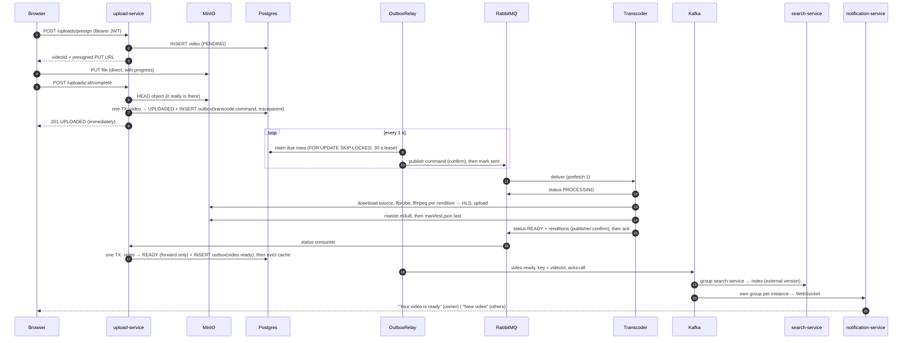

# Interview Questions — Mini YouTube

System-design questions drawn from this project, easiest first. Every answer is grounded in what the
code actually does; the `ADR-0xx` references point to [DECISIONS.md](DECISIONS.md) for the full
reasoning and what was rejected.

- [Level 1 — Foundations](#level-1--foundations)
- [Level 2 — Building blocks](#level-2--building-blocks)
- [Level 3 — Control flow: what happens when a file is uploaded](#level-3--control-flow-what-happens-when-a-file-is-uploaded)
- [Level 4 — Reliability and consistency](#level-4--reliability-and-consistency)
- [Level 5 — Architecture trade-offs](#level-5--architecture-trade-offs)
- [Level 6 — Scenarios: "it is 2 a.m. and..."](#level-6--scenarios-it-is-2-am-and)
- [Level 7 — Design extensions](#level-7--design-extensions)
- [Definitions — "what is X?" quick answers](#definitions--what-is-x-quick-answers)

---

## Level 1 — Foundations

### 1. What are the main components, and what does each own?

| Component            | Owns                                                             | Talks to                                     |
| -------------------- | ---------------------------------------------------------------- | -------------------------------------------- |
| web (React)          | UI, OIDC login (PKCE), HLS playback (hls.js)                     | upload / search APIs, WebSocket, edge, MinIO |
| upload-service       | Video metadata (Postgres), presigned URLs, outbox, views, status | Postgres, MinIO, RabbitMQ, Kafka, Redis      |
| transcoder-service   | ffmpeg → HLS renditions, master playlist                         | RabbitMQ, MinIO                              |
| search-service       | Elasticsearch index, `/search`, `/search/suggest`                | Kafka, Elasticsearch                         |
| notification-service | WebSocket fan-out of "video ready"                               | Kafka, Keycloak (JWKS)                       |
| MinIO                | Raw uploads (private) and HLS output (public read)               | —                                            |
| nginx edge           | Caching HLS in front of MinIO (a local CDN)                      | MinIO                                        |
| Keycloak             | Identity; issues JWTs                                            | —                                            |

Each service owns its data; nobody reads another service's database. They cooperate through APIs,
commands (RabbitMQ) and events (Kafka).

### 2. Why doesn't the video go through the upload service?

Bytes are the expensive part. The service only issues a **presigned URL** (a time-limited, signed PUT
to MinIO/S3); the browser uploads straight to storage. The API stays small and fast, scales on request
count rather than bandwidth, and never buffers gigabytes in memory. The server's only job afterwards is
`POST /uploads/:id/complete` to confirm the object exists.

### 3. What is HLS, and why not just serve the MP4?

HTTP Live Streaming splits a video into short segments (`seg_000.ts`, 4 s each here) per quality
(360p…1080p), each with an `index.m3u8` playlist, plus a `master.m3u8` listing the qualities. The player
downloads small files over plain HTTP, so:

- it can **switch quality between segments** as bandwidth changes (adaptive bitrate),
- seeking just fetches the segment at that time instead of a byte range of a huge file,
- every segment is a static, immutable file — ideal for CDN caching.

A single MP4 cannot adapt and is far less cache-friendly (ADR-031, ADR-032).

### 4. What does the nginx edge add if MinIO already serves the files?

It is a cache (a stand-in for a CDN), not a gateway. Segments never change, so the edge keeps them 30
days and tells browsers `immutable` for a year; playlists only 60 s. `proxy_cache_lock` collapses 20
simultaneous misses into one MinIO request, and `proxy_cache_use_stale` keeps cached videos playing
while MinIO is down. It also only exposes segment and playlist paths, so the bucket cannot be listed
through it (ADR-033).

### 5. RabbitMQ and Kafka are both "message brokers". Why use both?

They model different things (ADR-002):

|           | RabbitMQ (command)                                 | Kafka (event)                                      |
| --------- | -------------------------------------------------- | -------------------------------------------------- |
| Meaning   | "Transcode this video" — one worker must do it     | "This video is ready" — anyone may care            |
| Delivery  | Queue: each message to **one** consumer, then gone | Log: every **consumer group** reads it; it stays   |
| Strengths | ack/nack, retries, DLQ, prefetch back-pressure     | Replay, many independent readers, ordering per key |
| Here      | `transcoder.transcode-video`                       | `yt.video-events` → search, notifications          |

### 6. How does login work, and where is the token checked?

The web app uses OIDC Authorization Code + PKCE against Keycloak (a public client, no secret in the
browser). The access token (a JWT) goes in `Authorization: Bearer` to the upload service, which
verifies the signature with Keycloak's JWKS (cached, refetched on an unknown key id), plus issuer and
audience `yt-api`. The WebSocket cannot send headers, so the browser sends the token as its first
message instead — never in the URL, where proxies would log it (ADR-038).

---

## Level 2 — Building blocks

### 7. What is a presigned URL, and what can go wrong with it?

A URL carrying an HMAC signature over method, bucket, key, expiry (and here content type), made with
the storage credentials. Anyone holding it can do exactly that one operation until it expires (15 min
for uploads here). Pitfalls this project hit or guards against:

- **Host mismatch:** the signature covers the host. A service inside Docker talks to `minio:9000`, but
  the browser needs `localhost:9000`, so URLs are signed with `STORAGE_PUBLIC_ENDPOINT` while the
  service still talks to the internal address.
- **Checksums:** newer AWS SDKs add checksum headers that break browser PUTs on real S3, so checksum
  calculation is set to "when required".
- **Large files:** a single PUT is capped (5 GB on S3) and restarts from zero on failure; uploads switch
  to multipart with per-part presigned URLs and resume.

### 8. How do multipart uploads work here?

`POST /uploads/multipart` creates the upload in storage and plans parts (8 MB, or bigger so there are at
most 10,000). The browser asks for presigned URLs for batches of part numbers, PUTs parts in parallel,
and can ask "which parts are already stored?" to resume. `complete` joins the parts — after checking
the count and sizes, so a truncated upload is rejected. Abandoned uploads are cleaned up by a scheduled
job after `UPLOAD_PENDING_TTL_MINUTES`.

### 9. What is a quorum queue and a dead-letter queue?

A **quorum queue** is replicated with Raft across RabbitMQ nodes, so an acknowledged message survives a
node loss (a classic queue lives on one node). A **dead-letter queue (DLQ)** receives messages that
were rejected without requeue; here `transcoder.transcode-video.dlq`. Bad input (not a video) goes
there at once; it never loops (ADR-026, ADR-029).

### 10. How are retries done without a delayed-message plugin?

A consumer-less **retry queue** with a message TTL whose dead-letter target is the work exchange. A
transient failure republishes the command to the retry queue with an `x-yt-attempt` header and acks the
original; after the TTL (10 s) RabbitMQ moves it back to the work queue. After 3 attempts it goes to the
DLQ. The worker never sleeps and the queue never blocks behind a failing message (ADR-029).

### 11. What is a Kafka consumer group, and why do search and notifications use them differently?

A group is a set of consumers sharing a topic's partitions; each partition goes to one member, and the
group's committed offsets record progress.

- **search-service:** every instance uses the same group `search-service` → the partitions are split,
  each event is indexed once (work-sharing).
- **notification-service:** every instance uses its own group `notification-service-<random>`, reads
  from `latest` and never commits → every instance sees every event, because each holds a different
  set of browser sockets (fan-out). The cost: an event during a restart is missed — acceptable for a
  toast (ADR-038).

### 12. Why is the topic keyed by `videoId`, and why is it compacted?

Kafka orders messages only within a partition; the same key always lands on the same partition, so
all events of one video stay in order. **Compaction** keeps at least the latest record per key forever,
so a brand-new consumer group can rebuild its whole state (the search index) by reading from the start
— without asking the producer for anything (ADR-035, ADR-037).

### 13. What is cache-aside, and what exactly is cached?

Read: try Redis `video:<id>`; on a miss read Postgres and put the row in Redis with a 60 s TTL. Write:
change Postgres, **then** delete the key. The cache holds the database row, never the HTTP response,
because responses contain signed URLs that expire (ADR-042).

### 14. How do view counts work, and why are they "eventually consistent"?

`POST /videos/:id/views` runs one Redis Lua script: `SET views:seen:<id>:<viewer> NX EX 1800` and only if
that was new, `INCR views:pending:<id>` + add the id to a dirty set. Every 10 s a flusher pops dirty ids
(`SPOP`), takes their counts (`GETDEL`) and adds them to Postgres. The detail page shows Postgres +
pending (so you see your own view at once); the list shows Postgres only and lags by up to one flush.

### 15. What does `maxmemory-policy volatile-lru` protect?

Under memory pressure Redis evicts only keys that have a TTL (cache entries, dedupe markers). The view
counters have no TTL, so they can never be silently evicted before reaching Postgres. With
`allkeys-lru`, memory pressure would delete views.

### 16. How does search tolerate typos and partial words?

Two `should` clauses: a `multi_match` on `title^3` and `description` with `fuzziness: AUTO` (one or two
edits depending on word length), and a `bool_prefix` match on a `search_as_you_type` subfield, which
indexes edge n-grams and shingles, so the last half-typed word still matches. Autocomplete uses only the
prefix part. Highlighting is done in the browser with escaped text and `<mark>`, never HTML from the
index (ADR-037, ADR-039).

---

## Level 3 — Control flow: what happens when a file is uploaded

### 17. Walk through an upload from click to "your video is ready"

Step by step:

1. **Presign** — the service authenticates the JWT, creates a `PENDING` row with the owner, and signs a
   PUT URL for `raw-videos/<id>/source.mp4` (or starts a multipart upload for large files).
2. **Upload** — the browser PUTs straight to MinIO; the service is not involved.
3. **Confirm** — `complete` checks the object exists (and joins parts for multipart), then in **one
   transaction** moves the row to `UPLOADED` and writes a transcode command into the `outbox` table,
   with the request's trace context. It answers 201 at once; RabbitMQ being down does not fail it.
   A second `complete` is a no-op (conditional update on `status = PENDING`).
4. **Relay** — every second `OutboxRelay` claims due rows with `FOR UPDATE SKIP LOCKED` and a 30 s lease,
   publishes with publisher confirms (10 s timeout), and marks them sent; failures back off 1 s → 5 min.
5. **Transcode** — the transcoder gets one message at a time (prefetch 1), reports `PROCESSING`, probes
   the source, encodes each rung of the ladder up to the source height into 4 s HLS segments with
   aligned keyframes, uploads them to `hls-videos`, writes `master.m3u8` and finally `manifest.json`.
6. **Report** — it publishes `READY` (with renditions) or `FAILED` (with a reason) to `yt.video-status`
   and waits for the broker's confirm before acking the command.
7. **Apply** — the upload service applies the status only as a forward move (`UPDATE … WHERE status IN
(allowed previous)`), and for `READY` writes a `video.ready` outbox row in the same transaction; then
   evicts the cache entry.
8. **Fan out** — the relay publishes `video.ready` to Kafka. search-service indexes it (one group);
   every notification-service instance pushes it to its sockets (own groups).
9. **Watch** — the web app, which polled `GET /videos/:id` every 2 s, gets `READY`, loads
   `master.m3u8` from the edge, and hls.js picks a quality. The first play records a view.

The whole journey is **one trace** in Tempo: the outbox row stores the `traceparent` and the relay
publishes inside it; RabbitMQ and Kafka headers carry it onwards (ADR-045).

### 18. What does the user see during that time?

The upload card shows a progress bar (XHR upload progress, since `fetch` cannot report it), then the
watch page polls every 2 s and shows "Waiting for the transcoder…" → "Transcoding…" → the player. A
toast arrives over WebSocket when it is ready. If transcoding failed, the reason is shown and the
original file still plays.

### 19. What happens when a viewer presses play?

hls.js loads `master.m3u8` through the edge, picks a starting level, and loads segments ~30 s ahead
(`maxMaxBufferLength: 30`). Each segment download measures bandwidth; ABR switches levels at segment
boundaries, capped to the player size. Seeking fetches the segment containing the target time directly.
A second viewer gets the same segments as edge `HIT`s (ADR-034).

---

## Level 4 — Reliability and consistency

### 20. What is the dual-write problem, and how does the outbox solve it?

"Update the database and publish a message" are two systems with no shared transaction: if the publish
fails after the commit, the video is stuck; if the commit fails after the publish, the worker processes
a video the database does not know. The **transactional outbox** turns the message into a row written
in the same transaction as the state change. A separate relay publishes rows later and marks them sent.
Either both the state and the intent exist, or neither (ADR-028).

### 21. Why `FOR UPDATE SKIP LOCKED` plus a lease, and not just `FOR UPDATE`?

`SKIP LOCKED` lets several relay replicas claim disjoint batches without waiting on each other. The
lease (`locked_until = now + 30 s`) is written in a short claim transaction, so **no transaction stays
open while publishing** — a slow broker cannot hold row locks. If a relay crashes, its lease expires
and another relay picks the rows up.

### 22. The outbox gives "at least once". Where do duplicates come from, and who handles them?

A relay can crash after the broker accepted a message but before marking the row sent; a timed-out
publish can still be delivered later (this was observed: one Kafka outage produced 3 copies of one
event). So every consumer is idempotent:

- **Transcoder** — dedupes on the videoId: if `manifest.json` (written last) exists, the work is done.
- **Status consumer** — forward-only conditional update; a repeated `READY` changes no row and writes
  no second `video.ready`.
- **Search** — document id = videoId, `version = occurredAt` with external versioning: an equal or older
  version is rejected (409 → "stale").
- **Notifications** — remembers the last 1000 `eventId`s.

### 23. Why does the transcoder write `manifest.json` last?

It is the commit marker. A crash halfway leaves segments but no manifest, so a redelivered command
re-encodes; a complete run leaves a manifest, so a duplicate command skips straight to reporting
`READY`. Object storage has no transactions — the last write is the commit.

### 24. Why must the status update be "forward only"?

Messages can arrive late or twice: a slow `PROCESSING` may land after `READY`. `UPDATE … WHERE id = ?
AND status IN (allowed previous states)` makes stale events change nothing. `FAILED → READY` is
allowed, for a dead-lettered command that was replayed and succeeded.

### 25. Explain the difference between transient and permanent failures in the transcoder

Permanent (`PermanentFailureException`, e.g. ffprobe finds no video stream): retrying cannot help → DLQ
at once and status `FAILED` with the reason. Transient (storage timeout, process killed): retry after 10
s, up to 3 attempts, then DLQ. A killed process (exit 137) is deliberately transient — the file is not
the problem.

### 26. How are a Kafka consumer's offsets committed, and why does that matter?

Manually, **after** the event is indexed, skipped or dead-lettered — at-least-once. With auto-commit
the offset could move past an event that then fails to index, and it would be lost. While
Elasticsearch is down the consumer retries the same event with backoff and the partition waits;
skipping ahead would also lose it. A malformed event goes to the DLT and is committed, so one poison
message cannot block the partition forever.

### 27. Why is the cache evicted after the commit, not before?

Evicting before the commit lets a concurrent reader load the **old** row from Postgres (the update is
not visible yet) and put it back into Redis, where it stays until the TTL. Evicting after the commit
narrows that window; the 60 s TTL bounds what remains (a reader that loaded just before the update).

---

## Level 5 — Architecture trade-offs

### 28. Why does the upload service publish `video.ready`, not the transcoder?

Only the upload service knows whether a `READY` is new or a duplicate (the forward-only update), and it
owns the title, description and owner that consumers need. The event carries that state, so search and
notifications never call back. The transcoder would also need its own outbox (ADR-036).

### 29. Why event-carried state rather than "videoId only, call me for details"?

Consumers stay up when the upload service is down, there is no burst of callbacks after each event,
and a replay from the compacted topic rebuilds the index without the producer. The cost is a contract
to evolve carefully — solved with a shared Zod schema in `@yt/contracts`, a generated JSON Schema and
AsyncAPI document, and a tolerant reader (consumers ignore unknown fields).

### 30. How do you change the search mapping without downtime?

The API reads the alias `videos`, which points at `videos-v1`. Create `videos-v2` with the new mapping,
start a consumer with a **new group id** (it reads the compacted topic from the beginning and fills v2),
then switch the alias atomically and delete v1. Producers are untouched.

### 31. Why polling for status (every 2 s) instead of WebSocket, given there is a WebSocket?

Polling the detail endpoint is the source of truth and works with no extra infrastructure; it stops as
soon as the video leaves `UPLOADED/PROCESSING`. The WebSocket is a best-effort hint (missed during a
restart) that triggers an immediate refetch. Using it as the only channel would need replay or an inbox
per user.

### 32. Why one consumer group per notification instance — what are the limits?

Fan-out without shared state, which is simple and correct while instances are few. With thousands of
instances, each reads every event (N× traffic) and offsets are never stored. The usual next step is one
shared group that writes to Redis pub/sub (or a per-user inbox table) which instances subscribe to.

### 33. How is the system observable end to end?

All four services export traces, metrics and logs over OTLP to one collector (Tempo, Prometheus, Loki
in Grafana). Context crosses HTTP (auto-instrumented), RabbitMQ (amqplib instrumentation; Spring AMQP
observation), the outbox (stored `traceparent`), and Kafka (manual producer/consumer spans with headers).
Business metrics (`yt.outbox.pending`, `yt.search.events{outcome}`, `yt.views.recorded{outcome}`) tell
whether the pipeline works, not just whether processes are up. Telemetry is opt-in per environment
(ADR-043–047).

### 34. Why `suppressTracing` around the outbox poll?

The relay queries Postgres every second. Without suppression each poll is a root trace — 86,400 noise
traces a day per instance. Inside a poll, each publish still restores the row's stored context, so the
real work joins the upload's trace.

### 35. Why ports and adapters (hexagonal) in the transcoder?

`TranscodeService` depends on `StoragePort`, `TranscoderPort` and `VideoStatusPort`, not on S3, ffmpeg
or RabbitMQ. Tests use fakes; ffmpeg can run as installed binaries or a container per call; MinIO vs S3
is configuration. ArchUnit enforces that the domain never imports adapters.

---

## Level 6 — Scenarios: "it is 2 a.m. and..."

### 36. RabbitMQ is down for 10 minutes. What happens?

Uploads keep succeeding: `complete` only writes the outbox row and returns 201. The relay's publishes
fail and back off (1 s doubling, max 5 min); `yt_outbox_pending` rises on the dashboard. The
transcoder's listener reconnects. When RabbitMQ is back, the backlog drains and videos transcode;
nothing is lost, users just wait longer. Status events published by the transcoder use confirms, so a
`READY` it could not publish is retried, not lost.

### 37. Kafka hangs (accepts connections, never answers). What breaks?

Before the fix: a send waits forever, and since the relay runs one drain at a time, transcode commands
stopped too. Now every publish has a 10 s timeout inside the 30 s lease; a timeout counts as a failed
attempt, and the rest of that message type's batch is skipped (left leased) so commands still flow.
After Kafka resumes, queued sends may also arrive — duplicates with the same `eventId`, which consumers
already ignore (ADR-036).

### 38. Redis is paused. Do requests fail or hang?

Neither. `RedisGuard` races every call against 500 ms, then skips Redis for 5 s. Reads fall back to
Postgres (measured: 638 ms for the first request, 115 ms for the next). A view during the outage is
written straight to Postgres — unless the Redis call **timed out**, because then it may still apply
when Redis wakes up; writing Postgres too could count it twice, so that view is accepted unconfirmed.

### 39. Elasticsearch is down. What do users see, and is anything lost?

Search returns an error with a retry button; everything else works. The indexer keeps retrying the
same event (backoff to 30 s) without committing, so the partition waits. When Elasticsearch returns,
indexing resumes from the uncommitted offset — measured: an event produced during the outage was
searchable right after.

### 40. Someone publishes garbage to `yt.video-events`. What happens?

search-service fails to parse it against the contract, writes it to `yt.video-events.dlt` with headers
`dlt-reason`, `dlt-source` (`topic/partition@offset`) and `dlt-consumer`, commits, and moves on.
`yt_search_events_total{outcome="dead-letter"}` rises and the Loki warning panel shows it.
notification-service ignores it. Unknown **event types** are skipped, not dead-lettered — other
consumers may handle them.

### 41. A user uploads a 5 GB file over a flaky connection

The web app uses multipart: three parts upload in parallel with per-part presigned URLs, and the video
id is remembered in `localStorage` for that file. If the tab or network dies, picking the same file
again asks which parts are stored and uploads only the rest. `complete` refuses a part count or size
mismatch. If the user gives up, the cleanup job aborts the multipart upload and deletes the `PENDING`
row after the TTL.

### 42. A video stays "Transcoding…" forever. How do you investigate?

1. `select type, attempts, last_error, sent_at from outbox where payload->>'videoId' = '<id>'` — was the
   command published?
2. RabbitMQ: depth of `transcoder.transcode-video`, `.retry`, `.dlq` (`http/rabbitmq.http`).
3. Take the `traceparent` from the outbox row → Tempo shows exactly which hop stopped.
4. Transcoder logs for that trace id in Loki; `manifest.json` in `hls-videos/<id>/`.
5. Common causes: transcoder not running (queue depth grows), status event dead-lettered
   (`upload-service.video-status.dlq`), status consumer down.

### 43. View counts look too low after a deploy

Check the flusher: counts sit in `views:pending:*` until a flush; shutdown runs a last flush. If Redis
was evicting, the policy must be `volatile-lru`. Behind a proxy without `TRUST_PROXY_HOPS`, every
viewer looks like the proxy's IP, so dedupe merges everyone into one viewer — the count stops rising.

### 44. A viewer on a slow mobile network says playback stalls

The dashboard and edge logs show the bitrates fetched. Playback measured at 1.2 Mbps: ABR stepped 720p
→ 360p within ~23 s and never paused; the 30 s buffer cap is what made the drop visible quickly (the
default prefetched ~160 s). Next steps would be a lower rung (240p) or shorter segments (2 s) for faster
adaptation, at the cost of more requests.

### 45. Search results show an old title after the owner renamed a video

Renames are not implemented yet; but the design answer: emit `video.updated` from the outbox with a
newer `occurredAt`; the indexer's external version accepts it and an older replay can never overwrite
it. The cache entry is evicted on the same write.

---

## Level 7 — Design extensions

### 46. How would you scale transcoding?

Run more transcoder replicas: they are competing consumers on one quorum queue, prefetch 1 keeps each
busy with one job. Autoscale on **queue depth**, not CPU (a queue backlog means demand; CPU is already
pegged per job) — KEDA's RabbitMQ scaler. Bigger wins: parallelise renditions (one message per
rendition), or segment-level parallel encoding for long videos.

### 47. How would you make the platform multi-region?

Storage replicates (S3 cross-region) behind a global CDN; that covers playback, the read-heavy path.
Metadata stays single-writer (one primary region with read replicas) or moves to partitioned ownership
by region. Kafka uses MirrorMaker or a managed multi-region cluster for events; consumers in each region
build local search indexes. Uploads go to the nearest region's bucket and are processed there.

### 48. How would you add private or unlisted videos?

Today HLS output is public-read (segments cannot each be presigned). Options: signed cookies or a token
checked at the edge (CloudFront signed cookies, or nginx `auth_request` against the API), or AES-128 HLS
encryption with a key endpoint that checks access. The search indexer would index only public videos,
and the event would carry visibility.

### 49. How would you do recommendations or trending?

A new consumer group on `yt.video-events` plus a views event stream. Trending: windowed counts
(Kafka Streams/Flink or Redis sorted sets with decay). Because events are a compacted, replayable log, a
new service can backfill from history without touching producers — the same property that lets search
rebuild its index.

### 50. What would you change before production?

- TLS everywhere; Elasticsearch, Kafka and Redis with authentication; secrets from a vault, not env files.
- Replicas: Kafka RF 3, quorum queues on 3 RabbitMQ nodes, Postgres HA, Elasticsearch replicas.
- Images built in CI on pinned base images; readiness/liveness probes; resource limits; HPA (Stage 5).
- Sampling below 100 % for traces; log retention; SLOs and alerts on the business metrics.
- Load tests (k6) to find the real bottleneck before guessing.

---

## Definitions — "what is X?" quick answers

Short answers for definition-style questions. Each one says where the idea is used in this project.

### Observability

**D1. What is `suppressTracing`?**
A function from `@opentelemetry/core` that returns a copy of a context with a "tracing suppressed" flag.
While that context is active, every tracer (yours and the auto-instrumentations for HTTP, pg, Redis)
returns a non-recording span: nothing is created or exported. The SDK span processor uses it around export, so
sending spans does not create spans. Here, `untraced()` in `libs/ts/telemetry/src/messaging.ts` wraps
the outbox poll and the view-count flush, which would otherwise start a new trace every second. Work
inside it that calls `withStoredContext(...)` still traces, because that context is rebuilt from
`ROOT_CONTEXT` plus the stored `traceparent`, which drops the flag (ADR-045).

**D2. Trace, span, span kind?**
A **trace** is one request's whole journey; a **span** is one timed operation inside it, with a parent.
**Kind** says the role: `SERVER`/`CLIENT` for HTTP, `PRODUCER`/`CONSUMER` for messaging, `INTERNAL`
otherwise. Kafka spans here are created by hand with `PRODUCER`/`CONSUMER`, because the client has no
instrumentation.

**D3. What is context propagation / `traceparent`?**
Passing the trace id across process boundaries. W3C `traceparent` is
`00-<trace-id>-<parent-span-id>-<flags>`, carried in HTTP headers, AMQP and Kafka headers, and here
also in the outbox column `trace_context` so a relay running later continues the request's trace.

**D4. What is OTLP?**
OpenTelemetry Protocol: one wire format for traces, metrics and logs, over HTTP (4318) or gRPC (4317).
All services send to the `otel-lgtm` collector, which fans out to Tempo, Prometheus/Mimir and Loki.

**D5. Counter, gauge, histogram?**
Counter only goes up (views recorded). Gauge is a current value read on demand (outbox pending rows,
an observable callback). Histogram records a distribution so you can ask for p95 (request latency).

**D6. Sampling?**
Deciding which traces to keep. Local runs keep 100 %; production would sample head-based (decide at the
start) or tail-based (decide after seeing errors/latency in the collector).

### Messaging

**D7. Transactional outbox?**
Write the business change and the event row in the same database transaction; a relay publishes rows
later and marks them sent. No event is lost if the broker is down, and no event exists for a rolled-back
change. The cost is at-least-once delivery (ADR-028, ADR-036).

**D8. At-most-once, at-least-once, exactly-once?**
At-most-once may lose, never duplicates. At-least-once never loses, may duplicate - this project's
choice everywhere. Exactly-once is at-least-once plus idempotent processing, which is what the
consumers implement.

**D9. Idempotency?**
Doing the same operation twice has the effect of doing it once. Examples: the transcoder skips a video
whose HLS manifest already exists; Elasticsearch uses external versioning so a replayed older event is ignored;
the view Lua script uses `SET NX` so a refresh is not a second view.

**D10. Command vs event?**
A command asks one receiver to do something (`transcode-video` on RabbitMQ, one worker handles it).
An event states a fact that already happened (`video.ready` on Kafka, any number of consumers react).

**D11. Prefetch / backpressure?**
Prefetch is how many unacked messages a broker pushes to a consumer. The transcoder uses 1 (one heavy
job at a time); the status consumer uses 10. It is backpressure: a slow consumer is not flooded.

**D12. Ack, nack, requeue?**
Ack removes the message. Nack with requeue puts it back (risk: hot loop). Nack without requeue sends it
to the dead-letter exchange - the default here (`default-requeue-rejected: false`).

**D13. Partition, offset, consumer lag?**
A partition is an ordered, append-only log; an offset is a position in it; **lag** is the newest offset
minus the group's committed offset - how far behind a consumer is. KEDA can scale on it.

**D14. Log compaction?**
Kafka keeps at least the newest record per key and deletes older ones in the background. The topic
becomes "current state per video", replayable from the start (ADR-035).

**D15. KRaft?**
Kafka's built-in Raft metadata quorum that replaced ZooKeeper. The local broker runs as both broker
and controller.

**D16. Raft / quorum?**
A consensus algorithm: a leader replicates a log and a write is committed once a majority has it. Used
by RabbitMQ quorum queues and KRaft. With 3 nodes you survive 1 failure.

**D17. Poison message?**
A message that fails every time it is processed (bad schema, not a video). It must go to a DLQ/DLT
rather than block the queue or partition (ADR-029, ADR-037).

### Data and caching

**D18. Cache-aside vs write-through?**
Cache-aside: the app reads the cache, on a miss loads the DB and fills the cache; writes go to the DB
and evict the key (used here). Write-through: every write updates the cache and the DB together.

**D19. Cache stampede?**
Many requests miss the same expired key at once and all hit the database. Mitigations: short TTL with
jitter, single-flight locks, or serving stale while one request refreshes.

**D20. TTL and eviction policy?**
TTL is a key's lifetime. The eviction policy decides what Redis deletes when memory is full;
`volatile-lru` only touches keys with a TTL, protecting the view counters (ADR-042).

**D21. Why Lua in Redis?**
A script runs atomically on the server: check-then-increment happens with no other command in between
and in one round trip.

**D22. Eventual consistency?**
Replicas or derived stores converge after a delay instead of instantly. Search index, view totals and
the list page are all eventually consistent with Postgres.

**D23. Index alias (Elasticsearch)?**
A name pointing at one or more real indexes. Code uses `videos`; the data lives in `videos-v1`. A
mapping change builds `videos-v2` and swaps the alias atomically - zero-downtime reindex (ADR-037).

**D24. Inverted index, n-gram, fuzziness?**
An inverted index maps each term to the documents containing it. N-grams index word fragments for
prefix matching (`search_as_you_type`). Fuzziness allows 1-2 character edits (Levenshtein distance).

**D25. Database migration?**
A versioned, ordered schema change (Prisma `migrate`). Run once per deploy, before the new code: in
Kubernetes it is a Helm pre-install/pre-upgrade hook Job.

### Video delivery

**D26. HLS, segment, playlist?**
HLS cuts video into short files (segments) listed in an `.m3u8` playlist per quality, plus a master
playlist listing the qualities. Plain HTTP, so any CDN can cache it.

**D27. ABR (adaptive bitrate)?**
The player measures throughput and buffer and switches quality between segments. `hls.js` does it here,
capped to the player size (ADR-034).

**D28. CDN / edge?**
Caches close to users that serve static bytes. Locally the nginx "edge" on 8088 plays that role for
`/hls/` (ADR-033).

**D29. Presigned URL?**
A URL signed with storage credentials that allows one operation on one object until it expires
(see Q7).

### Security

**D30. OIDC, OAuth 2.0, JWT?**
OAuth 2.0 delegates access; OIDC adds identity (who logged in) on top. A JWT is a signed token with
claims (`sub`, `iss`, `aud`, `exp`). Keycloak issues them; services only verify them.

**D31. JWKS?**
The issuer's public keys as JSON at a URL. Services fetch and cache them to verify JWT signatures
without calling Keycloak per request; `kid` in the token header picks the key (`OIDC_JWKS_URL`).

**D32. PKCE?**
Proof Key for Code Exchange: a browser app sends a hash of a random secret when starting login and the
secret when exchanging the code, so a stolen authorization code is useless. The realm requires `S256`.

**D33. CORS?**
The browser's rule for which other origins may call an API. The API answers with allowed origins
(5173, 8090); it does not protect the server, it protects users' browsers.

**D34. `trust proxy`?**
Tells Express how many proxy hops to trust when reading `X-Forwarded-For`, so `req.ip` is the client,
not nginx. Too many hops lets a client spoof its IP (`TRUST_PROXY_HOPS`).

### Containers and Kubernetes

**D35. Multi-stage build, BuildKit secret?**
Multi-stage builds compile in one stage and copy only the output into a small runtime image. A BuildKit
secret (`--secret`) is mounted for one `RUN` and never stored in a layer - used for `.npmrc`/CA files
(ADR-048).

**D36. Why run as a non-root uid?**
A container escape or file-write bug then has no root privileges. Images here run as uid 10001.

**D37. Startup, readiness, liveness probe?**
Startup: give a slow boot time before other probes run. Readiness: "send me traffic" - failing removes
the pod from the Service. Liveness: "I am stuck" - failing restarts the container. All three are in
`yt-common/_workload.tpl`.

**D38. HPA vs KEDA?**
The HPA scales replicas on resource metrics (CPU, memory). KEDA feeds external metrics (queue depth,
Kafka lag) to an HPA it manages, and can scale to zero - right for the transcoder (ADR-049).

**D39. Helm umbrella chart, library chart, hook?**
An umbrella chart installs subcharts as one release. A library chart only holds shared templates
(`yt-common`). A hook is a resource run at a lifecycle point, e.g. the migration Job.

**D40. Requests vs limits?**
Requests are what the scheduler reserves and what HPA percentages are measured against. Limits are a
ceiling: CPU is throttled, memory over the limit gets the container OOM-killed.
