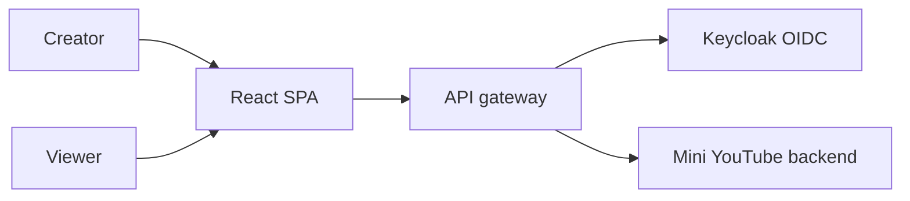
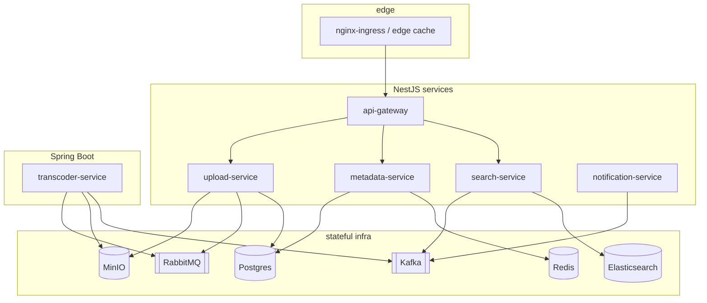
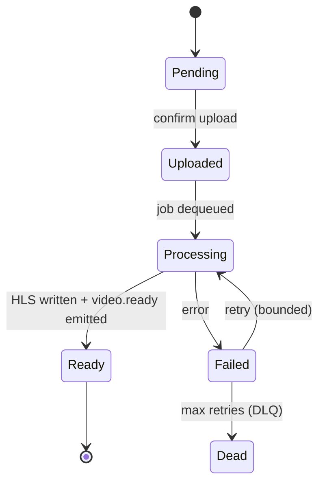
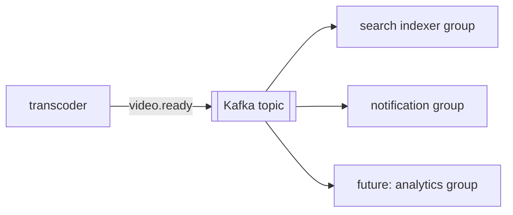
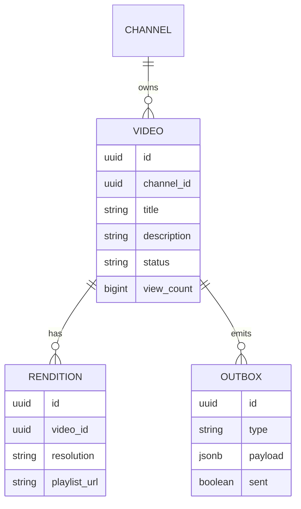
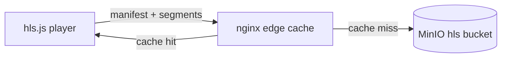
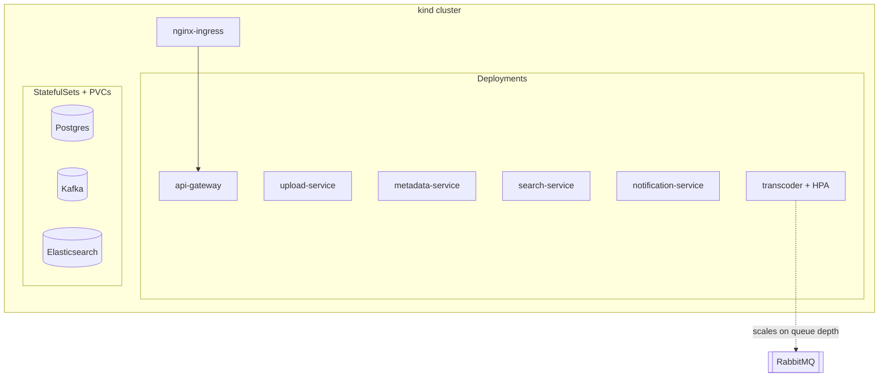

# Architecture

System architecture for the Mini YouTube Clone. Diagrams use Mermaid (see the
`doc-with-mermaid` skill). This document holds the _how_; the _what/why_ is in
[`PRD.md`](PRD.md) and [`LEARNING-GOALS.md`](LEARNING-GOALS.md), and decisions are logged in
[`DECISIONS.md`](DECISIONS.md).

## 1. Context



Creators upload; viewers browse, search, watch, and get notified. Keycloak is the identity
authority; the backend is a set of open-source-backed microservices.

## 2. Service map



- **api-gateway** — BFF: auth, routing, rate limiting, WebSocket relay.
- **upload-service** — presigned URLs, metadata write, enqueues transcode, writes outbox.
- **metadata-service** — video/channel CRUD (source of truth), cache reads.
- **transcoder-service** — RabbitMQ consumer, ffmpeg, writes HLS, emits `video.ready`.
- **search-service** — Kafka consumer → Elasticsearch indexer, query API.
- **notification-service** — Kafka consumer → WebSocket to viewers.

## 3. Upload → playable flow

```mermaid
sequenceDiagram
  participant C as Client
  participant GW as API gateway
  participant UP as upload-service
  participant S as MinIO
  participant Q as RabbitMQ
  participant TR as transcoder
  participant K as Kafka
  C->>GW: request upload URL
  GW->>UP: create video (status=Pending)
  UP-->>C: presigned PUT URL
  C->>S: PUT raw bytes
  C->>GW: confirm upload
  GW->>UP: confirm upload
  UP->>UP: TX { mark Uploaded; insert outbox(transcode.cmd) }
  UP-->>C: 201 Uploaded
  UP->>Q: outbox relay publishes transcode.cmd (retries until confirmed)
  Q->>TR: deliver job
  TR->>S: read raw
  TR->>S: write HLS renditions
  TR->>K: video.ready (via outbox)
  K->>C: notification (WebSocket) "ready"
```

## 4. Video lifecycle (state)



## 5. Event fan-out



One event, many independent consumer groups. A new consumer can replay history to backfill
without changing the producer. See the `messaging-patterns` skill.

## 6. Transactional outbox

```mermaid
sequenceDiagram
  participant S as service
  participant DB as Postgres
  participant RL as outbox relay
  participant K as Kafka
  S->>DB: TX { update video; insert outbox(video.ready) }
  RL->>DB: poll unsent outbox
  RL->>K: publish video.ready
  RL->>DB: mark sent
```

Avoids the dual-write problem: the DB change and the intent-to-publish commit atomically; a
relay forwards reliably. Consumers are idempotent because delivery is at-least-once.

## 7. Data model (core)



Postgres is the **source of truth**. Elasticsearch documents and Redis counts are _derived_
and rebuildable from it.

## 8. Streaming path



Adaptive bitrate: the player reads a manifest and fetches segments at a quality matched to
bandwidth. nginx caches segments at the edge and serves byte-range requests for seeking.

## 9. Deployment (local k8s)



Stateless services are Deployments; data stores are StatefulSets. The transcoder autoscales
on RabbitMQ queue depth (HPA). See the `k8s-kind-helm` skill.

## 10. Cross-cutting

- **Config:** environment-driven, typed and validated (zod / Spring `AppProperties`).
- **Auth:** Keycloak-issued JWTs, verified at the gateway and services.
- **Observability:** OTLP from every service into grafana/otel-lgtm; one trace spans
  HTTP → RabbitMQ → Kafka. See the `observability-otel` skill.
- **Contracts:** OpenAPI (REST) + AsyncAPI (events) in `libs/ts/contracts`.
- **Patterns:** layered MVC for CRUD services; ports & adapters for infra-heavy services
  (transcoder, search, notification). See `ADR-011`.
